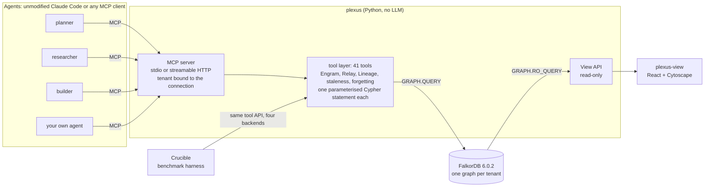
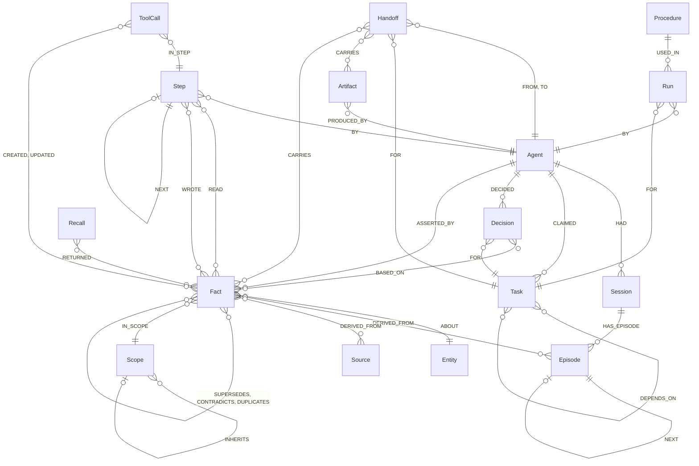

# Plexus

**One shared graph brain for AI agent teams.** Claude Code, Hermes and other harnesses remember in text files and
coordinate through task lists. Plexus gives a team of agents one FalkorDB graph instead: every memory, task, claim, handoff
and decision is a node, every "because" is an edge. Agents connect over MCP. The team remembers across sessions, works
without stepping on each other, and can answer *"why did we decide that?"* and *"what did the builder know at step 17?"*
with a graph query, not a guess.

**Track: Track 02, Agent Memory and Coordination** · Graph Hacks (WeMakeDevs × FalkorDB).

| | |
|---|---|
| Live demo | `<RENDER_URL>` (one container on Render Free: the View, the read-only API and a public MCP endpoint, see [Live demo](#live-demo)) |
| Demo video (≤ 3 min) | `<VIDEO_URL>` (script: [`docs/VIDEO_SCRIPT.md`](docs/VIDEO_SCRIPT.md)) |
| Blog post | [`docs/BLOG_DRAFT.md`](docs/BLOG_DRAFT.md) |
| Run it yourself | `docker compose up -d --wait --build`, see [Setup](#setup) (Docker is the only requirement) |

Plexus itself contains **no LLM and no LLM credentials**. The agents in the demo are the unmodified `claude` binary; every
Plexus tool is a deterministic Cypher query. Only synthetic data is used (a fictional "Acme Notes API" team).

## What it does, by Track 02 focus area

| Focus area | Plexus feature | Where to see it |
|---|---|---|
| Episodic, semantic and procedural memory | `Episode` chains, scoped `Fact`s on `Entity`s with validity windows, `Procedure` → `Run` success rates | MCP: `remember_episode`, `assert_fact`, `recall`, `log_procedure_run`, `best_procedure` · queries `plexus/queries/engram/` · View: Explorer. *Procedures are implemented and tested but are not exercised in the recorded demo and have no View page.* |
| Persistent conversation history | `Agent` → `Session` → `Episode` chains. Every `claude -p` turn is a new process; the recording has 16 sessions and the agents still build on each other's facts | View: Inventory (16 `Session`, 5 `Episode`), Explorer · MCP: `start_session`, `remember_episode` |
| Shared state and handoffs | Dependency-aware atomic claims with leases and heartbeats, dead-agent reclaim, `Handoff` nodes carrying artifacts and facts, `Decision`-`BASED_ON`→`Fact` | View: Flow (live `ToolCall` feed), Why · MCP: `claim_next_task`, `heartbeat`, `handoff`, `record_decision` · queries `plexus/queries/relay/` |
| High-concurrency reads and writes | One statement per operation; writes serialise per graph, so load spreads over tenant graphs. Crucible L1 races 10-200 workers; L4 measures the ceiling | View: Results (L1, L4) · [`docs/BASELINE.md`](docs/BASELINE.md) |
| Separate memory per user or tenant | One FalkorDB graph per tenant (`plexus_t_<tenant>`); the tenant is bound to the connection and is never a tool argument; `Scope` nodes (user, project, global) with `INHERITS`. Crucible C5 probes leak 0 rows | View: tenant selector in the header · [`docs/mcp.md`](docs/mcp.md) · `plexus/queries/engram/create_scope.cypher` |
| Memory updates over time | Validity windows (`valid_from`/`valid_to`), `SUPERSEDES`, `CONTRADICTS` and duplicate detection at write time, "as of T" queries, forget-by-source and quarantine | View: Time Machine, Explorer · MCP: `assert_fact`, `as_of`, `fact_history`, `forget_source`, `quarantine_source` |
| Explainability | `why(decision)` and `why_recalled` return graph paths (decision → facts → agent → step → source); `knew_at(agent, step)`; `who_knew(fact)` | View: Why, Time Machine · MCP: `why`, `why_recalled`, `who_knew`, `knew_at` |

## Architecture



- **Engram** (memory), **Relay** (coordination) and **Lineage** (provenance) are three modules over one graph. They are
  Python wrappers around named `.cypher` files in [`plexus/queries/`](plexus/queries/); the loader rejects any parameter a
  header does not declare, and nothing is string-formatted into Cypher.
- **Every tool call is audited in the graph.** The MCP runtime opens a Lineage `Step` per (agent, n) and writes a `ToolCall`
  with `IN_STEP` and `CREATED`/`UPDATED` edges to the nodes it touched. The Flow page and the Time Machine are traversals of
  these edges.
- **The View never writes.** The API holds a read-only client (`GRAPH.RO_QUERY` only); `plexus-view` talks to it and nothing else.
- **No LLM inside Plexus (D-002).** Semantic matching uses a local CPU embedding model (bge-small via fastembed). The agents are
  unmodified Claude Code processes started with `claude -p ... --mcp-config`, signed in with the owner's own subscription;
  Plexus never sees a Claude credential. Hermes is not used in any published run (D-003). The decisions and their reasoning
  are in [`docs/DECISIONS.md`](docs/DECISIONS.md).
- **Crucible** swaps only the backend (files, SQLite, vector store, Plexus) behind an identical tool API; see
  [Benchmark results](#benchmark-results-crucible-honest).

## Graph data model

Full reference with every property, index and convention: [`docs/graph-model.md`](docs/graph-model.md). Every node has a
UUID `id` and `created_at` (epoch ms). There is no `datetime()` on FalkorDB 6.0.2, so time is integer epoch milliseconds, and an
open-ended `valid_to` is `9999999999999`.



The diagram is a summary (cardinalities are indicative); the tables are exact.

| Label | Module | Key properties |
|---|---|---|
| `Agent` | all | `name, role, harness` |
| `Scope` | Engram | `kind: user\|project\|global, name` |
| `Session`, `Episode` | Engram | `Session(agent_id, started_at, ended_at)`; `Episode(role, text, at, step, embedding)` |
| `Entity` | Engram | `name, norm_name, kind, embedding` |
| `Fact` | Engram | `subject_id, predicate, value, valid_from, valid_to, status: active\|superseded\|quarantined\|forgotten, embedding` |
| `Source` | Lineage | `uri, kind, trust, title, text` |
| `Procedure`, `Run` | Engram | `Procedure(name, task_type, steps_json)`; `Run(at, success, notes)` |
| `Task` | Relay | `status: open\|claimed\|done\|failed, priority, lease_until, claimed_by, version` |
| `Handoff`, `Artifact`, `Decision` | Relay | `Handoff(at, note)`; `Artifact(kind, uri, hash, summary)`; `Decision(text, at, flagged)` |
| `Step`, `ToolCall`, `Recall` | Lineage, audit | `Step(n, at, agent_id)`; `ToolCall(tool, query_name, run_time_ms, wrote)`; `Recall(query, k)` |

| Module | Relationships |
|---|---|
| Engram | `HAD`, `HAS_EPISODE`, `NEXT` (episodes), `ABOUT`, `DERIVED_FROM` (→ Episode, Source or Fact), `IN_SCOPE`, `INHERITS`, `SUPERSEDES`, `DUPLICATES`, `CONTRADICTS`, `ASSERTED_BY {at}`, `USED_IN`, `BY`, `FOR` |
| Relay | `DEPENDS_ON`, `CLAIMED {at, lease_until, reclaimed_from}`, `FROM`, `TO`, `FOR`, `CARRIES`, `DECIDED`, `BASED_ON`, `PRODUCED_BY`, `VERIFIED_BY {at, independent}` |
| Lineage and audit | `Step -[:BY]-> Agent`, `READ`, `WROTE`, `NEXT` (steps), `IN_STEP`, `CREATED`, `UPDATED`, `RETURNED {rank, score}` |

Indexes: range indexes on `id` and `created_at` for all 16 labels plus the hot filters (`Fact.predicate/valid_to/status`,
`Task.status`, `Step.n`, `ToolCall.at`, `Entity.norm_name`); full-text on `Entity.name`, `Fact.value`, `Episode.text`;
384-d cosine vector indexes on `Entity/Fact/Episode.embedding`; UNIQUE constraints on `Task/Fact/Agent/Decision/Handoff.id`.
The recorded real run holds 247 nodes and 708 edges (14 labels, 26 relationship types).

## The Cypher queries the product depends on

Every statement lives in a named, parameterised file under [`plexus/queries/<area>/<name>.cypher`](plexus/queries/) with a
header (purpose, params, returns, mode) and is loaded by name; 69 files in all. The complete index with a "why it is a graph
query" for each is [`docs/queries.md`](docs/queries.md). The ones the product cannot work without:

| Query | What it does | Why it is a graph query |
|---|---|---|
| [`engram/assert_fact`](plexus/queries/engram/assert_fact.cypher) | Finds the entity's current facts, classifies duplicate / supersede / contradiction, writes the `Fact` with `ABOUT`, `IN_SCOPE`, `ASSERTED_BY`, `DERIVED_FROM`, `SUPERSEDES`, `CONTRADICTS` | Conflict detection and validity-window closing are traversals plus one atomic multi-edge write; per-graph write serialisation makes it race-free |
| [`engram/recall`](plexus/queries/engram/recall.cypher) | Hybrid recall: vector seeds, scope inheritance (`INHERITS*0..3`), validity filter at time `t`, 1-hop sibling expansion | Vector index seed, then scope and entity traversals, in one read |
| [`engram/remember_episode`](plexus/queries/engram/remember_episode.cypher) | Appends an `Episode` to the session's chain | The chain tail is found by traversal and extended atomically, so concurrent appends cannot fork it |
| [`relay/create_tasks`](plexus/queries/relay/create_tasks.cypher) | Creates a task DAG with `DEPENDS_ON` edges, all or nothing | The dependency graph is stored as edges |
| [`relay/claim_next_task`](plexus/queries/relay/claim_next_task.cypher) | Claims the best ready task (all `DEPENDS_ON` targets `done`, free or lease-expired), sets lease, `version+1`, `CLAIMED` edge | Readiness is a traversal; the claim is one serialised graph write, so two agents never win the same task (also covers dead-agent reclaim) |
| [`relay/dependents_of`](plexus/queries/relay/dependents_of.cypher) | One BFS level of tasks that depend on a frontier | Transitive "what is blocked if T fails" (`blocked_by_failure`) |
| [`relay/handoff`](plexus/queries/relay/handoff.cypher) | `Handoff` + `FROM`/`TO`/`FOR` + `CARRIES` artifacts and facts; a bad id writes nothing | A handoff is a node linking agents, a task and its evidence, traversable later |
| [`relay/record_decision`](plexus/queries/relay/record_decision.cypher) | `Decision` with `DECIDED`, `FOR` and all-or-nothing `BASED_ON` facts | Decisions point at the exact facts they rest on |
| [`lineage/why_edges`](plexus/queries/lineage/why_edges.cypher) | Provenance subgraph of a decision or fact | Variable-length paths from decision to fact to agent, step and source: this is the "why" answer |
| [`lineage/knew_at`](plexus/queries/lineage/knew_at.cypher) | Time machine: facts an agent had read at or before step N that were still valid then, plus what it wrote | Step chain + `READ`/`WROTE` edges + the fact's validity window |
| [`lineage/as_of`](plexus/queries/lineage/as_of.cypher) | The fact valid at time t for (subject, predicate), nearest scope first | Entity → `ABOUT` → Fact with a validity filter and scope traversal |
| [`lineage/who_knew`](plexus/queries/lineage/who_knew.cypher) | Agents whose steps `READ` a fact, and who asserted it | `READ` edges one hop each way |
| [`lineage/forget_source`](plexus/queries/lineage/forget_source.cypher) | Marks every fact reaching a `Source` through `DERIVED_FROM*1..5` as forgotten and flags the decisions that rest on them | The cascade follows derivation edges, in one atomic write |
| [`lineage/quarantine`](plexus/queries/lineage/quarantine.cypher) | Reversible version of the above (stretch feature); returns the blast radius (readers, decisions, handoffs) | Blast radius is a traversal back out through `READ`, `BASED_ON`, `CARRIES` |
| [`audit/record_tool_call`](plexus/queries/audit/record_tool_call.cypher) | Writes a `ToolCall` with `IN_STEP` and `CREATED`/`UPDATED` edges to what the tool touched | The Flow page draws these edges |
| [`view/flow`](plexus/queries/view/flow.cypher) | Tool calls in order with the nodes each created or updated | A traversal of `ToolCall` → `CREATED`/`UPDATED`; also the SSE feed |
| [`crucible/strip_edges`](plexus/queries/crucible/strip_edges.cypher) | **Ablation only:** deletes `DEPENDS_ON`, `BASED_ON`, `DERIVED_FROM`, `READ` in bounded batches | Measures which features break without the edges |

Three of them in the form the demo uses (run in the FalkorDB Browser on graph `plexus_t_demo`, or see
[`docs/demo.md`](docs/demo.md) for more):

```cypher
// Why did the team move to v2?
MATCH (d:Decision) WHERE d.text STARTS WITH 'Adopt'
MATCH (d)-[:BASED_ON]->(f:Fact)-[:DERIVED_FROM]->(s:Source)
MATCH (f)-[:ASSERTED_BY]->(a:Agent)
OPTIONAL MATCH (f)-[:SUPERSEDES]->(old:Fact)
RETURN d.text, f.value, a.id, s.uri, old.value   // v2, researcher, acme-docs/06_api_style_guide_v2.md, v1

// Who reclaimed what after the builder died?
MATCH (a:Agent)-[c:CLAIMED]->(t:Task) WHERE c.reclaimed_from <> ''
RETURN a.id, t.id, c.reclaimed_from              // researcher, t03-design-endpoints, builder

// Which decisions rest on a fact that is no longer true?
MATCH (d:Decision)-[:BASED_ON]->(f:Fact) WHERE f.status <> 'active' RETURN d.text, f.value, f.status
```

## Why FalkorDB is the core (and the ablation that shows it)

FalkorDB is the only state store. There is no SQLite or JSON copy of the memory. Recall, dependency-aware claims, `why`,
time travel, contradiction detection, forget cascades and tenant isolation are graph queries, and the Flow page is a
traversal of the audit edges.

The test of that claim is an **ablation**: delete four relationship types (`DEPENDS_ON`, `BASED_ON`, `DERIVED_FROM`, `READ`)
and see what stops working.

- **Crucible ablation** ([`docs/BASELINE.md`](docs/BASELINE.md)): **7 of 7** capabilities that use those edges break
  (dependency-aware claims, `blocked_by_failure`, `why` for decisions and for facts, `knew_at`, `who_knew`, cascading forget);
  **5 of 5** controls are unaffected (as-of, recall, contradiction flags, supersession, exclusive claims). Re-running the
  dependency-order test (C4) with the edges stripped gives 181 tasks started before their dependencies finished, and the
  forget test (C8) gives 60 forgotten facts still returned (0 and 0 on the intact graph).
- **Live version on the real recording** (`plexus demo ablation`: 6 edge-dependent features and 2 controls on the demo
  tenant, a smaller set than Crucible's):

  ```bash
  docker compose run --rm plexus-cli demo ablation --tenant demo
  ```

  It copies the tenant with `GRAPH.COPY`, strips the four edge types in the copy and runs the same probes on both. Output on
  the Sonnet recording: `why(decision)` goes from "3 supporting facts, 2 agents, 3 sources" to 0 facts and 0 sources;
  `knew_at` from 5 facts to 0; with `DEPENDS_ON` gone, 11 tasks are claimable on a fresh board with unmet dependencies;
  **6 of 6 features break, 2 of 2 controls are unaffected**, and the original tenant is verified untouched. Open the copy
  (`demo_ablated`, kept unless you pass `--drop`) in the View to see the same graph without those edges. Details:
  [`docs/demo.md`](docs/demo.md).

What the ablation does **not** show: that nothing else could store these relations. SQLite (B1) answers some of the same
provenance questions with recursive CTEs, and the benchmark below reports where it ties.

## Benchmark results (Crucible, honest)

Crucible swaps only the backend behind an identical tool API: **B0** files (flock + atomic replace), **B1** SQLite
(transactions), **B2** vector store (same local embedder), **P** Plexus. Everything else is fixed (same agents' prompts,
model, scenario, budgets, seeds). Exact-match scoring, no LLM judge. Full methodology, pre-registration and failure analysis:
[`docs/BASELINE.md`](docs/BASELINE.md); the same numbers are in the View's Results page.

| Layer | What we found | How to read it |
|---|---|---|
| **L1** correctness under concurrency (C1-C8, 10 seeded runs per case) | **All four arms pass with 0 violations.** Plexus does **not** win on claims, leases, dependency order, as-of, tenant probes or forgetting: a competent file store or SQLite ties it. The one measured difference: C7 near-duplicate paraphrases, where B0/B1 catch 0% and B2/Plexus miss 25% (30 of 120 pairs, heavy rewordings) | The graph is not claimed to be more correct on these |
| **L4** performance | **SQLite is faster than Plexus on the median claim at every worker count** (0.10 vs 1.75 ms at 1 worker; 0.82 vs 570.9 ms at 200) but has worse tail latency at 200 workers (p99 2.18 s vs 1.86 s). Plexus server-side time stays at 1-4 ms; the rest is queueing, because FalkorDB serialises writes per graph. **Plexus scales across tenant graphs: 678 → 1025 → 1174 ops/s on 1, 4, 16 graphs (+73%)**, while SQLite peaked at 4 and fell at 16 (1103 → 1480 → 500; 16 files contend on one disk) | Raw claim speed is not Plexus's case. B0/B1/B2 are in-process libraries and the Plexus arms cross a container network |
| **L2** provenance and time questions (43 questions, one Acme project) | **Tie on accuracy:** P 43/43, B0 43/43, B1 43/43, B2 40/43 (93.0%). The whole history fits in the 32k-character context, so the LLM reads everything. Plexus costs 0 tokens (vs 13-16k tokens and $0.05-0.06 per question for B0/B1) and ~2.5 ms vs ~5 s | A tie on accuracy; the difference is cost, latency and determinism. Plexus uses a hand-written Cypher per question family |
| **L2 at scale** (pre-registered; 20 sprints of history, 10.4-16.6× the context cap, 36 questions) | **P 36/36 (100%), B1 32/36 (88.9%), B0 30/36 (83.3%), B2 23/36 (63.9%).** Wilson 95%: P 90.4-100, B1 74.7-95.6, B0 68.1-92.1, B2 47.6-77.5. Paired sign test: P vs B0 6-0, p = 0.031; **P vs B1 4-0, p = 0.125, not distinguishable from noise**; P vs B2 13-0, p < 0.001. B0/B1 failures were join-heavy provenance questions and one transitive dependency, not class-wide questions; accuracy did not decay with how early the sprint was. B0/B1 spent about 20-22k tokens and $0.08-0.09 per question (about 5 s) against 0 tokens and a few milliseconds | A gap, but a small one: the intervals of P and B0/B1 overlap, and the B1 gap is within sampling noise. Not a claim that Plexus is "better at memory" in general |
| **Ablation** | 7 of 7 edge-dependent capabilities break, 5 of 5 controls unaffected | The graph does real work (above) |

**Methodology limits** (the Results page and `report.md` print the full list): synthetic data; one scenario family; one model
(`claude-sonnet-5-5`); LLM arms run once per question; 36-43 questions; scripted worker threads on one machine against a
single-node database; the L2 baselines see their own artifacts at an equal 32,000-character cap, selected by BM25 or top-12
cosine; Plexus answers each question family with hand-written Cypher, which favours Plexus, while every L2-scale question
names its sprint, which favours retrieval; L2-scale asks no questions that aggregate across sprints (the strongest case for a
graph), and the procedures family was not measured; L3 (end-to-end LLM teams with injected faults) was only piloted and is not
in the results; Hermes is excluded from all published runs. Do not compare these numbers with vendor-reported LoCoMo or
LongMemEval scores. Raw files: [`plexus/src/plexus/crucible/results/`](plexus/src/plexus/crucible/results/).

Reproduce: `docker compose --profile bench run --rm crucible all --quick` (about 2 min; the full run takes about 24 min)
writes L1 + L4 + ablation. The L2 and L2-at-scale answers are cached in `plexus/demo_data/crucible/`, so a rerun is free and
byte-reproducible; `python -m plexus.crucible.combine` merges everything into `latest-all.json`, which the Results page serves.

## Live demo

`<RENDER_URL>`: one Docker container on Render Free runs FalkorDB 6.0.2, the read-only View API, an MCP endpoint over
HTTP and the static View. How to deploy it yourself (with the keep-awake pinger) and the safety controls:
[`docs/deploy.md`](docs/deploy.md).

- **Read-only tenants `demo`** (the real Claude Sonnet recording) **and `demo_scripted`** are restored from the recordings on
  every boot. Browse them in the View: pick the tenant in the header.
- **No LLM runs on the public site.** The only LLM runs are the recorded ones.
- **Bring your own agent:** the public MCP endpoint accepts writes only on tenants named `team_` + 4 to 24 lowercase letters or
  digits, at `<RENDER_URL>/mcp/t/team_xxxx` (see [Bring your own agent](#bring-your-own-agent)). Every MCP tool call on `demo*`
  is refused, even a read, because every Plexus tool call writes an audit `ToolCall` node.
- **Anything in a `team_` graph is public** (the tenant name is routing, not authentication, and the View lists every
  tenant). Put nothing private in it. Idle `team_` graphs are deleted after 24 h, and a restart drops them all.
- Rate limit: 60 MCP requests per minute per IP. Request bodies are capped at 512 KiB; at most 50 tenant graphs exist.
- Verified locally under `-m 512m --cpus 0.5`: boot in 5 to 14 s, peak 332 MiB (cgroup; 322 MiB by `docker stats`), 40/40
  checks of `deploy/verify.py`. The deployment on Render itself has not been verified yet.
- The first request after 15 idle minutes wakes the service (about a minute plus the reseed) unless an uptime pinger is set up.

## Setup

You need **Docker with Compose v2** and nothing else (no Python, no Node). The first `up` builds two images (about 4 minutes,
about 1 GB of images including FalkorDB). This exact path was run from a fresh clone (4 services healthy after 216 s, then the
replay; evidence in [`docs/TESTING.md`](docs/TESTING.md)).

```bash
git clone <this repo> plexus && cd plexus
cp .env.example .env                    # optional: the defaults work; edit it only if a host port below is already taken
docker compose up -d --wait --build     # builds and starts FalkorDB 6.0.2, the View API, the MCP server and the View
                                        # (--build matters if an older plexus:dev image exists: compose would reuse it)
docker compose run --rm plexus-cli demo replay acme-claude-sonnet --tenant demo    # load the recorded real Claude Code run
```

| Open | What |
|---|---|
| http://localhost:5180 | **The View.** Pick tenant `demo` in the header: Explorer, Flow, Time Machine, Why, Inventory and **Results** (the Crucible benchmark: L1, L2, L2 at scale, L4, ablation) |
| http://localhost:3000 | FalkorDB Browser (the raw graph: graph `plexus_t_demo`) |
| http://localhost:8080/api/tenants | the read-only View API (`/api/demo/inventory`, `/api/demo/graph`, `/api/results`, ...) |
| http://localhost:8765/mcp/t/demo | the MCP server (streamable HTTP, tenant `demo` pinned by the path). It is an MCP endpoint, not a web page: a plain browser GET answers `Bad Request: Missing session ID`, which is normal. Connect an MCP client (see [Bring your own agent](#bring-your-own-agent)) |

**How you know it worked:** the replay prints `replayed 'acme-claude-sonnet' into tenant 'demo': 247 nodes, 708 edges (matches
meta.json: True)`; Inventory shows 247 nodes, 708 edges, 14 labels, 26 edge types; Flow lists 83 tool calls; Results shows
L1 all-pass and the L2-at-scale section. If the View's tenant list is empty, the replay has not run yet.

The replay restores a recording of three unmodified Claude Code agents (planner, researcher, builder) building the fictional
"Acme Notes API". `docker compose run --rm plexus-cli demo list` shows the other recordings. Ports are `FALKORDB_PORT`,
`FALKORDB_BROWSER_PORT`, `PLEXUS_API_PORT`, `PLEXUS_MCP_PORT` and `PLEXUS_VIEW_PORT` in `.env`; after changing
`PLEXUS_API_PORT` or `PLEXUS_VIEW_PORT` run `docker compose up -d --build` (the View bakes the API address into its bundle).
All compose ports are published on `127.0.0.1` only.

**More to try** (all synthetic data; no LLM and no credentials are involved in any of it):

```bash
# watch the Flow page while scripted agents play the whole scenario (builder killed, task reclaimed, style guide v1 -> v2)
docker compose run --rm plexus-cli demo live --scripted --tenant live --speed 4
# cut DEPENDS_ON / BASED_ON / DERIVED_FROM / READ in a copy of the tenant and see which features break (docs/demo.md)
docker compose run --rm plexus-cli demo ablation --tenant demo
# the benchmark itself (L1 + L4 + ablation; ~20 min full, --quick ~2 min): results land in plexus/src/plexus/crucible/results/
docker compose --profile bench run --rm crucible all --quick
docker compose down -v                  # stop and delete everything
```

The Results page reads `plexus/src/plexus/crucible/results/latest-all.json` (L1 + L4 + ablation from the compose run, merged
with the full L2 and L2-scale runs by `python -m plexus.crucible.combine`), mounted into the API as `PLEXUS_RESULTS_PATH`.

### Bring your own agent

Any MCP client can connect. The server has 41 tools (`start_session`, `assert_fact`, `recall`, `claim_next_task`,
`record_decision`, `why`, `knew_at`, ...; the list is in [`docs/mcp.md`](docs/mcp.md)). Every tool takes an `agent_id`; the
tenant is part of the connection, never an argument.

**Against the public demo** (once `<RENDER_URL>` is live): use a `team_` tenant of your own. It is public and deleted after 24 h
idle; `demo` itself refuses every tool call.

```bash
claude mcp add --transport http plexus <RENDER_URL>/mcp/t/team_alice01
# or in a config file:  { "mcpServers": { "plexus": { "type": "http", "url": "<RENDER_URL>/mcp/t/team_alice01" } } }
claude    # then ask: "Use the plexus tools as agent 'alice': start a session, assert the fact subject=API predicate=version value=v1,
          #            then assert value=v2, recall 'API version', and call why/as_of to show what changed"
```

**Against your local stack** (tenant `byo` is created on first use; leave `demo` alone if you want the recording untouched):

```bash
claude mcp add --transport http plexus http://127.0.0.1:8765/mcp/t/byo         # streamable HTTP, compose service plexus-mcp
# or stdio, generated for this checkout (fastest start-up; needs Python 3.12 + uv, see the contributor block below):
cd plexus && uv sync && FALKORDB_PORT=6379 uv run plexus mcp-config --tenant byo --out ../mcp.local.json
claude --mcp-config ../mcp.local.json
```

To question the recorded run with your own Claude Code, point it at tenant `demo` on the local stack
(`http://127.0.0.1:8765/mcp/t/demo`; your calls add audit nodes to that tenant) and ask: *"Use the plexus tools: recall the
API version, then explain why we chose v2."* Expect `start_session`, `recall` (value `v2`) and `why` on the "Adopt API v2"
decision. For headless `claude -p`, pass `--allowedTools "mcp__plexus__*"` and check `permission_denials` (a blocked tool
still exits 0). Details: [`docs/mcp.md`](docs/mcp.md).

<details><summary>Without Docker for the app (Python 3.12 + <code>uv</code>, Node 22+): contributors and the full test suite</summary>

```bash
docker compose up -d falkordb                       # or scripts/agent_db.sh <slot> for a throw-away test database
cd plexus && uv sync
FALKORDB_PORT=6379 uv run plexus demo replay acme-claude-sonnet --tenant demo
FALKORDB_PORT=6379 uv run plexus-api &             # View API on :8080
cd ../plexus-view && npm ci && npm run dev         # View on http://localhost:5180 (VITE_FIXTURES=1 for the built-in dataset)
cd ../plexus && uv run plexus mcp-config --tenant demo   # an MCP config for Claude Code for this checkout (docs/mcp.md)
```

Quick dev loop (see `docs/PLAN.md` and `CLAUDE.md`; the full gate and the owner's manual checklist are in `docs/TESTING.md`):

```bash
bash scripts/agent_db.sh 10                                   # FalkorDB 6.0.2 on 127.0.0.1:6310
cd plexus && PLEXUS_TEST_DB_PORT=6310 uv run pytest -q        # throwaway graphs, deleted in teardown
bash ../scripts/agent_db.sh rm 10
```

</details>

## Repo layout

```text
plexus/                  the product (Python 3.12, uv)
  queries/<area>/*.cypher  every Cypher statement, named and parameterised (69 files)
  src/plexus/            graph (client, schema, tenancy), engram, relay, lineage, audit, mcp, api, embed, demo, crucible
  demo_data/             the Acme scenario, recordings (acme-claude-sonnet, acme-scripted, pilot-haiku), Crucible questions and caches
  tests/                 pytest against throw-away graphs
plexus-view/             the demonstrator (React + TypeScript + Cytoscape); read-only
deploy/, render.yaml     the one-container public deployment
docs/                    graph-model, queries, PLAN, DECISIONS, BASELINE, demo, mcp, deploy, TESTING, AI_USAGE, VIDEO_SCRIPT, BLOG_DRAFT
scripts/                 agent_db.sh (throw-away FalkorDB), verify_readme.py (link and number checker)
docker-compose.yml       FalkorDB 6.0.2, plexus-api, plexus-mcp, plexus-view, plexus-cli, crucible (bench profile)
```

## Testing

[`docs/TESTING.md`](docs/TESTING.md) has the Definition of Ready for Testing with evidence and a step-by-step manual
checklist. At the last full run, 869 Python tests and 150 View tests passed (plus 34 unit tests for the deploy guard), and
`ruff` and the View's lint and typecheck were clean; tests that need a database use their own throw-away graphs. Known gaps
are listed there too: for example, a real Claude Code run has driven only 11 of the 41 tools (all 41 have an MCP contract
test), and the L1/L4 benchmark and the LLM arms are separate commands. `python scripts/verify_readme.py` checks that every
link in this README, the video script and the blog draft resolves and that the quoted numbers still match the results files.

## Docs

- [`docs/graph-model.md`](docs/graph-model.md): graph data model (diagram, labels, edges, indexes)
- [`docs/queries.md`](docs/queries.md): index of every Cypher query
- [`docs/BASELINE.md`](docs/BASELINE.md): benchmark plan, results, pre-registration of L2-scale
- [`docs/demo.md`](docs/demo.md), [`docs/mcp.md`](docs/mcp.md), [`docs/deploy.md`](docs/deploy.md): the demo scenario and ablation, the MCP server, the public deployment
- [`docs/DECISIONS.md`](docs/DECISIONS.md): every design decision with its reasoning
- [`docs/TESTING.md`](docs/TESTING.md), [`docs/VIDEO_SCRIPT.md`](docs/VIDEO_SCRIPT.md), [`docs/BLOG_DRAFT.md`](docs/BLOG_DRAFT.md)

## AI disclosure

Plexus was built with AI assistants: a Hermes Agent orchestrator and Claude Sonnet subagents wrote most of the code, tests,
queries and docs from specs, and unmodified Claude Code (the owner's own subscription) plays the demo agents and answers the
benchmark baselines; the product itself contains no LLM. The owner reviews the graph model, the `.cypher` files and the
architecture and records decisions in `docs/DECISIONS.md`; what has and has not been reviewed yet is stated, phase by phase,
in [`docs/AI_USAGE.md`](docs/AI_USAGE.md) (items marked _TBD_ are not yet reviewed).
