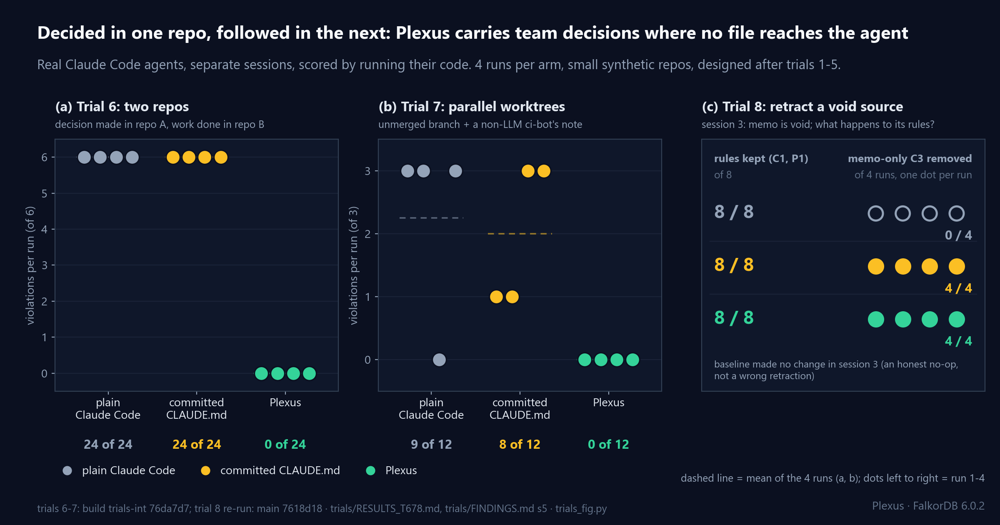
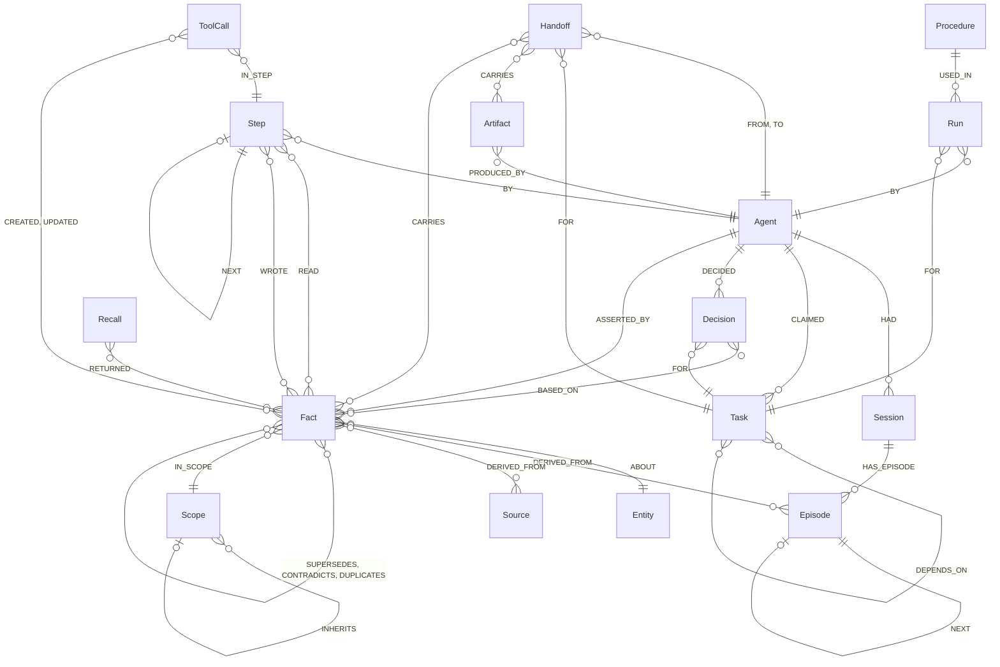

# Knewat

> Knewat was called Plexus until 2026-10-18; the GitHub repo redirects.

**One shared memory for agent teams that work across several repos.** Knewat tracks the decisions a team makes ahead of the
code, and who changed what and why. Agents connect over MCP to one FalkorDB graph per team: every memory, task, claim, handoff and
decision is a node, every "because" is an edge, so a rule decided in repo A is recalled in repo B and *"why did we decide that?"* is a
graph query, not a guess. This README is the setup guide; what was measured is in [docs/RESULTS.md](docs/RESULTS.md).

**Track: Track 02, Agent Memory and Coordination** · Graph Hacks (WeMakeDevs × FalkorDB).

| | |
|---|---|
| Live demo | <https://knewat-demo-sj3i.onrender.com> (one container on Render Free: the View, the read-only API and a read-only Cypher console; no MCP endpoint, see [docs/deploy.md](docs/deploy.md)) |
| Demo video (≤ 3 min) | `<VIDEO_URL>` |
| Blog post | `<BLOG_URL>` |
| Run it yourself | `docker compose up -d --wait --build`, see [Setup](#setup) (Docker is the only requirement) |

Knewat itself contains **no LLM and no LLM credentials**. The agents in the demo are the unmodified `claude` binary; every
Knewat tool is a deterministic Cypher query. Only synthetic data is used (a fictional "Acme Notes API" team).

## What it does, in one screen

- **Shared memory with provenance.** Facts with validity windows (`SUPERSEDES`, `CONTRADICTS`, "as of T"), every write linked to
  the agent, step and source that produced it; `why(decision)`, `knew_at(agent, step)` and `who_knew(fact)` are graph paths.
- **Coordination.** Dependency-aware atomic claims with leases and heartbeats, dead-agent reclaim, `Handoff` nodes, decisions
  `BASED_ON` facts. One graph per team (`knewat_t_<tenant>`), bound to the MCP connection.
- **Memory that notices change and fades.** A Claude Code hook marks facts suspect when the code they describe changes;
  unused facts lose rank, facts that decisions rest on are protected ([docs/staleness.md](docs/staleness.md), [docs/forgetting.md](docs/forgetting.md)).
- **45 MCP tools, 114 Cypher files, no LLM inside.** Architecture and the Track 02 focus-area map: [docs/ARCHITECTURE.md](docs/ARCHITECTURE.md).

**Measured, in brief** (full tables, caveats and builds: [docs/RESULTS.md](docs/RESULTS.md), [docs/BASELINE.md](docs/BASELINE.md), [docs/NUMBERS_STATUS.md](docs/NUMBERS_STATUS.md)):

| | Plain Claude Code | + `CLAUDE.md` | + Knewat |
|---|---|---|---|
| A team rule decided in repo A, later work in repo B (rule violations, of 24) | 24 | 24 | **0** |
| Parallel worktrees: rule on an unmerged branch + a non-AI ci-bot's notice (of 12) | 9 | 8 | **0** |
| Retract a void document: rules correctly kept (of 8) / void-only rule removed (of 4) | 8 / 0 | 8 / 4 | 8 / 4 |

Real Claude Code agents, separate sessions, scored by running their code; 4 runs per arm, small synthetic repos. Knewat wins where
no file reaches the next agent and ties a committed `CLAUDE.md` where one does. On the benchmark, cutting four edge types breaks
7 of 7 edge-dependent capabilities; all backends tie on correctness under 200 workers; SQLite is faster on the median claim;
hand-written SQL ties Knewat on provenance questions, while tool-less LLM readers fall to 30-32 of 36 once the history exceeds the context.



## Setup

You need **Docker with Compose v2** and nothing else (no Python, no Node). The first `up` builds two images (about 4 minutes,
about 1 GB of images including FalkorDB). This exact path was run from a fresh clone (4 services healthy after 216 s, then the
replay; evidence in [`docs/TESTING.md`](docs/TESTING.md); the 216 s is stale, measured on `p5-int`).

```bash
git clone <this repo> knewat && cd knewat
cp .env.example .env                    # optional: the defaults work; edit it only if a host port below is already taken
docker compose up -d --wait --build     # builds and starts FalkorDB 6.0.2, the View API, the MCP server and the View
                                        # (--build matters if an older knewat:dev image exists: compose would reuse it)
docker compose run --rm knewat-cli demo replay acme-claude-sonnet --tenant demo    # load the recorded real Claude Code run
```

| Open | What |
|---|---|
| http://localhost:5180 | **The View.** Pick tenant `demo` in the header: Explorer, Flow, Time Machine, Why, Inventory and **Results** (the Crucible benchmark: L1, L2, L2 at scale, L4, ablation) |
| http://localhost:3000 | FalkorDB Browser (the raw graph: graph `knewat_t_demo`) |
| http://localhost:8080/api/tenants | the read-only View API (`/api/demo/inventory`, `/api/demo/graph`, `/api/results`, ...) |
| http://localhost:8765/mcp/t/demo | the MCP server (streamable HTTP, tenant `demo` pinned by the path). It is an MCP endpoint, not a web page: a plain browser GET answers `Bad Request: Missing session ID`, which is normal. Connect an MCP client (see [Bring your own agent](#bring-your-own-agent)) |

**How you know it worked:** the replay prints `replayed 'acme-claude-sonnet' into tenant 'demo': 247 nodes, 708 edges (matches
meta.json: True)`; Inventory shows 247 nodes, 708 edges, 14 labels, 26 edge types; Flow lists 83 tool calls; Results shows
L1 all-pass and the L2-at-scale section. If the View's tenant list is empty, the replay has not run yet.

The replay restores a recording of three unmodified Claude Code agents (planner, researcher, builder) building the fictional
"Acme Notes API". `docker compose run --rm knewat-cli demo list` shows the other recordings. Ports are `FALKORDB_PORT`,
`FALKORDB_BROWSER_PORT`, `KNEWAT_API_PORT`, `KNEWAT_MCP_PORT` and `KNEWAT_VIEW_PORT` in `.env`; after changing
`KNEWAT_API_PORT` or `KNEWAT_VIEW_PORT` run `docker compose up -d --build` (the View bakes the API address into its bundle).
All compose ports are published on `127.0.0.1` only.

**More to try** (all synthetic data; no LLM and no credentials are involved in any of it):

```bash
# watch the Flow page while scripted agents play the whole scenario (builder killed, task reclaimed, style guide v1 -> v2)
docker compose run --rm knewat-cli demo live --scripted --tenant live --speed 4
# cut DEPENDS_ON / BASED_ON / DERIVED_FROM / READ in a copy of the tenant and see which features break (docs/demo.md)
docker compose run --rm knewat-cli demo ablation --tenant demo
# the benchmark itself (L1 + L4 + ablation; ~20 min full, --quick ~2 min): results land in knewat/src/knewat/crucible/results/
docker compose --profile bench run --rm crucible all --quick
docker compose down -v                  # stop and delete everything
```

The Results page reads `knewat/src/knewat/crucible/results/latest-all.json` (L1 + L4 + ablation from the compose run, merged
with the full L2 and L2-scale runs by `python -m knewat.crucible.combine`), mounted into the API as `KNEWAT_RESULTS_PATH`.

### Bring your own agent

Any MCP client can connect. The server has 45 tools (`start_session`, `assert_fact`, `recall`, `claim_next_task`,
`record_decision`, `why`, `knew_at`, ...; the list is in [`docs/mcp.md`](docs/mcp.md)). Every tool takes an `agent_id`; the
tenant is part of the connection, never an argument.

**Against the public demo:** not available. The MCP endpoint is not deployed until it is stable (D-016); run the local stack
(`docker compose up -d --wait --build`) and connect to `http://127.0.0.1:8765/mcp/t/<tenant>`.

```bash
claude mcp add --transport http knewat http://127.0.0.1:8765/mcp/t/alice
# or in a config file:  { "mcpServers": { "knewat": { "type": "http", "url": "http://127.0.0.1:8765/mcp/t/alice" } } }
claude    # then ask: "Use the knewat tools as agent 'alice': start a session, assert the fact subject=API predicate=version value=v1,
          #            then assert value=v2, recall 'API version', and call why/as_of to show what changed"
```

**Against your local stack** (tenant `byo` is created on first use; leave `demo` alone if you want the recording untouched):

```bash
claude mcp add --transport http knewat http://127.0.0.1:8765/mcp/t/byo         # streamable HTTP, compose service knewat-mcp
# or stdio, generated for this checkout (fastest start-up; needs Python 3.12 + uv, see the contributor block below):
cd knewat && uv sync && FALKORDB_PORT=6379 uv run knewat mcp-config --tenant byo --out ../mcp.local.json
claude --mcp-config ../mcp.local.json
```

To question the recorded run with your own Claude Code, point it at tenant `demo` on the local stack
(`http://127.0.0.1:8765/mcp/t/demo`; your calls add audit nodes to that tenant) and ask: *"Use the knewat tools: recall the
API version, then explain why we chose v2."* Expect `start_session`, `recall` (value `v2`) and `why` on the "Adopt API v2"
decision. For headless `claude -p`, pass `--allowedTools "mcp__knewat__*"` and check `permission_denials` (a blocked tool
still exits 0). Details: [`docs/mcp.md`](docs/mcp.md).

<details><summary>Without Docker for the app (Python 3.12 + <code>uv</code>, Node 22+): contributors and the full test suite</summary>

```bash
docker compose up -d falkordb                       # or scripts/agent_db.sh <slot> for a throw-away test database
cd knewat && uv sync
FALKORDB_PORT=6379 uv run knewat demo replay acme-claude-sonnet --tenant demo
FALKORDB_PORT=6379 uv run knewat-api &             # View API on :8080
cd ../knewat-view && npm ci && npm run dev         # View on http://localhost:5180 (VITE_FIXTURES=1 for the built-in dataset)
cd ../knewat && uv run knewat mcp-config --tenant demo   # an MCP config for Claude Code for this checkout (docs/mcp.md)
```

Quick dev loop (the full gate and the owner's manual checklist are in `docs/TESTING.md`):

```bash
bash scripts/agent_db.sh 10                                   # FalkorDB 6.0.2 on 127.0.0.1:6310
cd knewat && KNEWAT_TEST_DB_PORT=6310 uv run pytest -q        # throwaway graphs, deleted in teardown
bash ../scripts/agent_db.sh rm 10
```

</details>

## Live demo

<https://knewat-demo-sj3i.onrender.com>: one Docker container on Render Free runs FalkorDB 6.0.2, the read-only View API and the static View. The MCP
server is **not** deployed until it is stable ([D-016](docs/DECISIONS.md)). How to deploy it yourself (the CI gate, the
keep-awake check) and the safety controls: [`docs/deploy.md`](docs/deploy.md).

- **Read-only tenants `demo`** (the real Claude Sonnet recording) **and `demo_scripted`** are restored from the recordings on
  every boot. Browse them in the View: pick the tenant in the header.
- **Run your own Cypher** on the **Cypher** page (`POST /api/{tenant}/cypher`). It is read-only (`GRAPH.RO_QUERY`: the server
  refuses writes), 3 s timeout, at most 500 rows, no `LOAD CSV`, `CALL` limited to read procedures, 20 queries per minute per IP.
- **No LLM runs on the public site.** The only LLM runs are the recorded ones.
- Request bodies to the console are capped at 16 KiB. Nothing visitors do changes the graph; a restart reseeds it.
- Verified locally under `-m 512m --cpus 0.5` (36/36 checks of `deploy/verify.py`): boot in about 4 s, peak 88 MiB (cgroup;
  83 MiB by `docker stats`). The deployment on Render itself has not been verified yet.
- The first request after 15 idle minutes wakes the service (about a minute plus the reseed) unless the `live-smoke` workflow
  or an uptime pinger keeps it awake.

## Graph data model

Full reference with every property, index and convention: [`docs/graph-model.md`](docs/graph-model.md). Every node has a
UUID `id` and `created_at` (epoch ms). There is no `datetime()` on FalkorDB 6.0.2, so time is integer epoch milliseconds, and an
open-ended `valid_to` is `9999999999999`.



The diagram is a summary (cardinalities are indicative); the tables are exact.

| Label | Module | Key properties |
|---|---|---|
| `Agent` | all | `name, role, harness` |
| `Scope` | Engram | `kind: user\|project\|global, name` |
| `Session`, `Episode` | Engram | `Session(agent_id, started_at, ended_at)`; `Episode(role, text, at, step, embedding)` |
| `Entity` | Engram | `name, norm_name, kind, embedding` |
| `Fact` | Engram | `subject_id, predicate, value, valid_from, valid_to, status: active\|superseded\|quarantined\|forgotten, embedding` |
| `Source` | Lineage | `uri, kind, trust, title, text` |
| `Procedure`, `Run` | Engram | `Procedure(name, task_type, steps_json)`; `Run(at, success, notes)` |
| `Task` | Relay | `status: open\|claimed\|done\|failed, priority, lease_until, claimed_by, version` |
| `Handoff`, `Artifact`, `Decision` | Relay | `Handoff(at, note)`; `Artifact(kind, uri, hash, summary)`; `Decision(text, at, flagged)` |
| `Step`, `ToolCall`, `Recall` | Lineage, audit | `Step(n, at, agent_id)`; `ToolCall(tool, query_name, run_time_ms, wrote)`; `Recall(query, k)` |

| Module | Relationships |
|---|---|
| Engram | `HAD`, `HAS_EPISODE`, `NEXT` (episodes), `ABOUT`, `DERIVED_FROM` (→ Episode, Source or Fact), `IN_SCOPE`, `INHERITS`, `SUPERSEDES`, `DUPLICATES`, `CONTRADICTS`, `ASSERTED_BY {at}`, `USED_IN`, `BY`, `FOR` |
| Relay | `DEPENDS_ON`, `CLAIMED {at, lease_until, reclaimed_from}`, `FROM`, `TO`, `FOR`, `CARRIES`, `DECIDED`, `BASED_ON`, `PRODUCED_BY`, `VERIFIED_BY {at, independent}` |
| Lineage and audit | `Step -[:BY]-> Agent`, `READ`, `WROTE`, `NEXT` (steps), `IN_STEP`, `CREATED`, `UPDATED`, `RETURNED {rank, score}` |

Indexes: range indexes on `id` and `created_at` for all 16 labels plus the hot filters (`Fact.predicate/valid_to/status`,
`Task.status`, `Step.n`, `ToolCall.at`, `Entity.norm_name`); full-text on `Entity.name`, `Fact.value`, `Episode.text`;
384-d cosine vector indexes on `Entity/Fact/Episode.embedding`; UNIQUE constraints on `Task/Fact/Agent/Decision/Handoff.id`.
The recorded real run holds 247 nodes and 708 edges (14 labels, 26 relationship types).

## The Cypher queries the product depends on

Every statement lives in a named, parameterised file under [`knewat/queries/<area>/<name>.cypher`](knewat/queries/) with a
header (purpose, params, returns, mode) and is loaded by name; 114 files in all. The complete index with a "why it is a graph
query" for each is [`docs/queries.md`](docs/queries.md). The ones the product cannot work without:

| Query | What it does | Why it is a graph query |
|---|---|---|
| [`engram/assert_fact`](knewat/queries/engram/assert_fact.cypher) | Finds the entity's current facts, classifies duplicate / supersede / contradiction, writes the `Fact` with `ABOUT`, `IN_SCOPE`, `ASSERTED_BY`, `DERIVED_FROM`, `SUPERSEDES`, `CONTRADICTS` | Conflict detection and validity-window closing are traversals plus one atomic multi-edge write; per-graph write serialisation makes it race-free |
| [`engram/recall`](knewat/queries/engram/recall.cypher) | Hybrid recall: vector seeds, scope inheritance (`INHERITS*0..3`), validity filter at time `t`, 1-hop sibling expansion | Vector index seed, then scope and entity traversals, in one read |
| [`engram/remember_episode`](knewat/queries/engram/remember_episode.cypher) | Appends an `Episode` to the session's chain | The chain tail is found by traversal and extended atomically, so concurrent appends cannot fork it |
| [`relay/create_tasks`](knewat/queries/relay/create_tasks.cypher) | Creates a task DAG with `DEPENDS_ON` edges, all or nothing | The dependency graph is stored as edges |
| [`relay/claim_next_task`](knewat/queries/relay/claim_next_task.cypher) | Claims the best ready task (all `DEPENDS_ON` targets `done`, free or lease-expired), sets lease, `version+1`, `CLAIMED` edge | Readiness is a traversal; the claim is one serialised graph write, so two agents never win the same task (also covers dead-agent reclaim) |
| [`relay/dependents_closure`](knewat/queries/relay/dependents_closure.cypher) | Every task that transitively depends on a task, nearest first, in one statement | Transitive "what is blocked if T fails" (`blocked_by_failure`) |
| [`relay/handoff`](knewat/queries/relay/handoff.cypher) | `Handoff` + `FROM`/`TO`/`FOR` + `CARRIES` artifacts and facts; a bad id writes nothing | A handoff is a node linking agents, a task and its evidence, traversable later |
| [`relay/record_decision`](knewat/queries/relay/record_decision.cypher) | `Decision` with `DECIDED`, `FOR` and all-or-nothing `BASED_ON` facts | Decisions point at the exact facts they rest on |
| [`lineage/why_edges`](knewat/queries/lineage/why_edges.cypher) | Provenance subgraph of a decision or fact | Variable-length paths from decision to fact to agent, step and source: this is the "why" answer |
| [`lineage/knew_at`](knewat/queries/lineage/knew_at.cypher) | Time machine: facts an agent had read at or before step N that were still valid then, plus what it wrote | Step chain + `READ`/`WROTE` edges + the fact's validity window |
| [`lineage/as_of`](knewat/queries/lineage/as_of.cypher) | The fact valid at time t for (subject, predicate), nearest scope first | Entity → `ABOUT` → Fact with a validity filter and scope traversal |
| [`lineage/who_knew`](knewat/queries/lineage/who_knew.cypher) | Agents whose steps `READ` a fact, and who asserted it | `READ` edges one hop each way |
| [`lineage/forget_source`](knewat/queries/lineage/forget_source.cypher) | Marks every fact reaching a `Source` through up to 12 `DERIVED_FROM` hops (default 8, level by level) as forgotten (unless another `Source` still supports it: then only that link is dropped) and flags the decisions that rest on them | The cascade follows derivation edges, in one atomic write |
| [`lineage/quarantine`](knewat/queries/lineage/quarantine.cypher) | Reversible version of the above (stretch feature); hides a fact only when every one of its sources is quarantined; returns the blast radius (readers, decisions, handoffs) and the facts other sources keep alive | Blast radius is a traversal back out through `READ`, `BASED_ON`, `CARRIES` |
| [`audit/record_tool_call`](knewat/queries/audit/record_tool_call.cypher) | Writes a `ToolCall` with `IN_STEP` and `CREATED`/`UPDATED` edges to what the tool touched | The Flow page draws these edges |
| [`view/flow`](knewat/queries/view/flow.cypher) | Tool calls in order with the nodes each created or updated | A traversal of `ToolCall` → `CREATED`/`UPDATED`; also the SSE feed |
| [`crucible/strip_edges`](knewat/queries/crucible/strip_edges.cypher) | **Ablation only:** deletes `DEPENDS_ON`, `BASED_ON`, `DERIVED_FROM`, `READ` in bounded batches | Measures which features break without the edges |

Three of them in the form the demo uses (run in the FalkorDB Browser on graph `knewat_t_demo`, or see
[`docs/demo.md`](docs/demo.md) for more):

```cypher
// Why did the team move to v2?
MATCH (d:Decision) WHERE d.text STARTS WITH 'Adopt'
MATCH (d)-[:BASED_ON]->(f:Fact)-[:DERIVED_FROM]->(s:Source)
MATCH (f)-[:ASSERTED_BY]->(a:Agent)
OPTIONAL MATCH (f)-[:SUPERSEDES]->(old:Fact)
RETURN d.text, f.value, a.id, s.uri, old.value   // v2, researcher, acme-docs/06_api_style_guide_v2.md, v1

// Who reclaimed what after the builder died?
MATCH (a:Agent)-[c:CLAIMED]->(t:Task) WHERE c.reclaimed_from <> ''
RETURN a.id, t.id, c.reclaimed_from              // researcher, t03-design-endpoints, builder

// Which decisions rest on a fact that is no longer true?
MATCH (d:Decision)-[:BASED_ON]->(f:Fact) WHERE f.status <> 'active' RETURN d.text, f.value, f.status
```

## Repo layout

```text
knewat/                  the product (Python 3.12, uv)
  queries/<area>/*.cypher  every Cypher statement, named and parameterised (114 files)
  src/knewat/            graph (client, schema, tenancy), engram, relay, lineage, audit, mcp, api, embed, demo, crucible
  demo_data/             the Acme scenario, recordings (acme-claude-sonnet, acme-scripted, pilot-haiku), Crucible questions and caches
  tests/                 pytest against throw-away graphs
knewat-view/             the demonstrator (React + TypeScript + Cytoscape); read-only
deploy/, render.yaml     the one-container public deployment
docs/                    graph-model, queries, ARCHITECTURE, RESULTS, DECISIONS, BASELINE, demo, mcp, deploy, TESTING, AI_USAGE, NUMBERS_STATUS, forgetting, staleness
scripts/                 agent_db.sh (throw-away FalkorDB), verify_readme.py (link and number checker)
docker-compose.yml       FalkorDB 6.0.2, knewat-api, knewat-mcp, knewat-view, knewat-cli, crucible (bench profile)
```

## Testing

[`docs/TESTING.md`](docs/TESTING.md) has the Definition of Ready for Testing with evidence and a step-by-step manual
checklist. At the last full run, 1512 Python tests and 229 View tests passed (plus the unit tests for the deploy guard and app), and
`ruff` and the View's lint and typecheck were clean; tests that need a database use their own throw-away graphs. Known gaps
are listed there too: for example, a real Claude Code run has driven only 14 of the 45 tools (11 in the Acme run, 3 more in the P7 physio run; all 45 have an MCP contract
test), and the L1/L4 benchmark and the LLM arms are separate commands. `python scripts/verify_readme.py` checks that every
link in this README, the video script and the blog draft resolves and that the quoted numbers still match the results files.

> *(stale: the 1512 / 229 counts and the 55 guard-test count (now 61 deploy tests, run on this branch) were measured on `p9int` (2026-10-16). The current main passes 1825 Python tests with 2 skipped (full suite on the `integ` tree, identical to `7618d18`); the View and deploy-guard counts have not been re-run. See [docs/NUMBERS_STATUS.md](docs/NUMBERS_STATUS.md).)*

## Docs

- [`docs/ARCHITECTURE.md`](docs/ARCHITECTURE.md), [`docs/RESULTS.md`](docs/RESULTS.md): how it is built and what was measured (moved out of this README)
- [`docs/graph-model.md`](docs/graph-model.md): graph data model (diagram, labels, edges, indexes)
- [`docs/queries.md`](docs/queries.md): index of every Cypher query
- [`docs/BASELINE.md`](docs/BASELINE.md): benchmark plan, results, pre-registration of L2-scale
- [`docs/demo.md`](docs/demo.md), [`docs/mcp.md`](docs/mcp.md), [`docs/deploy.md`](docs/deploy.md): the demo scenario and ablation, the MCP server, the public deployment
- [`docs/DECISIONS.md`](docs/DECISIONS.md): every design decision with its reasoning
- [`docs/TESTING.md`](docs/TESTING.md), [`docs/NUMBERS_STATUS.md`](docs/NUMBERS_STATUS.md), [`docs/forgetting.md`](docs/forgetting.md), [`docs/staleness.md`](docs/staleness.md)

Plans, research notes, the video script and blog drafts that these documents cite by path are working files and are not in the repository.

## AI disclosure

Knewat was built with AI assistants: a Hermes Agent orchestrator and Claude Sonnet subagents wrote most of the code, tests,
queries and docs from specs, and unmodified Claude Code (the owner's own subscription) plays the demo agents and answers the
benchmark baselines; the product itself contains no LLM. The owner reviews the graph model, the `.cypher` files and the
architecture and records decisions in `docs/DECISIONS.md`; what has and has not been reviewed yet is stated, phase by phase,
in [`docs/AI_USAGE.md`](docs/AI_USAGE.md) (items marked _TBD_ are not yet reviewed).
