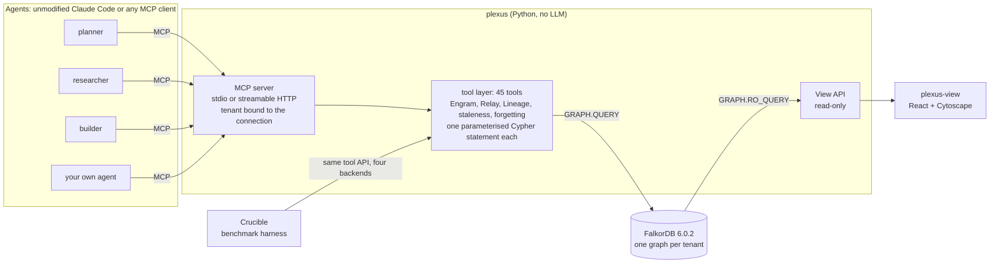

# Architecture and features

Moved out of the README so it stays a setup guide. The graph model is in [graph-model.md](graph-model.md), the queries in [queries.md](queries.md), the MCP tools in [mcp.md](mcp.md), the design decisions in [DECISIONS.md](DECISIONS.md).

## What it does, by Track 02 focus area

| Focus area | Plexus feature | Where to see it |
|---|---|---|
| Episodic, semantic and procedural memory | `Episode` chains, scoped `Fact`s on `Entity`s with validity windows, `Procedure` → `Run` success rates | MCP: `remember_episode`, `assert_fact`, `recall`, `log_procedure_run`, `best_procedure` · queries `plexus/queries/engram/` · View: Explorer. *Procedures are implemented and tested but are not exercised in the recorded demo and have no View page.* |
| Persistent conversation history | `Agent` → `Session` → `Episode` chains. Every `claude -p` turn is a new process; the recording has 16 sessions and the agents still build on each other's facts | View: Inventory (16 `Session`, 5 `Episode`), Explorer · MCP: `start_session`, `remember_episode` |
| Shared state and handoffs | Dependency-aware atomic claims with leases and heartbeats, dead-agent reclaim, `Handoff` nodes carrying artifacts and facts, `Decision`-`BASED_ON`→`Fact` | View: Flow (live `ToolCall` feed), Why · MCP: `claim_next_task`, `heartbeat`, `handoff`, `record_decision` · queries `plexus/queries/relay/` |
| High-concurrency reads and writes | One statement per operation; writes serialise per graph, so load spreads over tenant graphs. Crucible L1 races 10-200 workers; L4 measures the ceiling | View: Results (L1, L4) · [`docs/BASELINE.md`](BASELINE.md) |
| Separate memory per user or tenant | One FalkorDB graph per tenant (`plexus_t_<tenant>`); the tenant is bound to the connection and is never a tool argument; `Scope` nodes (user, project, global) with `INHERITS`. Crucible C5 probes leak 0 rows | View: tenant selector in the header · [`docs/mcp.md`](mcp.md) · `plexus/queries/engram/create_scope.cypher` |
| Memory updates over time | Validity windows (`valid_from`/`valid_to`), `SUPERSEDES`, `CONTRADICTS` and duplicate detection at write time, "as of T" queries, forget-by-source and quarantine | View: Time Machine, Explorer · MCP: `assert_fact`, `as_of`, `fact_history`, `forget_source`, `quarantine_source` |
| Explainability | `why(decision)` and `why_recalled` return graph paths (decision → facts → agent → step → source); `knew_at(agent, step)`; `who_knew(fact)` | View: Why, Time Machine · MCP: `why`, `why_recalled`, `who_knew`, `knew_at` |

## Architecture



- **Engram** (memory), **Relay** (coordination) and **Lineage** (provenance) are three modules over one graph. They are
  Python wrappers around named `.cypher` files in [`plexus/queries/`](../plexus/queries/); the loader rejects any parameter a
  header does not declare, and nothing is string-formatted into Cypher.
- **Every tool call is audited in the graph.** The MCP runtime opens a Lineage `Step` per (agent, n) and writes a `ToolCall`
  with `IN_STEP` and `CREATED`/`UPDATED` edges to the nodes it touched. The Flow page and the Time Machine are traversals of
  these edges.
- **The View never writes.** The API holds a read-only client (`GRAPH.RO_QUERY` only); `plexus-view` talks to it and nothing else.
- **No LLM inside Plexus (D-002).** Semantic matching uses a local CPU embedding model (bge-small via fastembed). The agents are
  unmodified Claude Code processes started with `claude -p ... --mcp-config`, signed in with the owner's own subscription;
  Plexus never sees a Claude credential. Hermes is not used in any published run (D-003). The decisions and their reasoning
  are in [`docs/DECISIONS.md`](DECISIONS.md).
- **Crucible** swaps only the backend (files, SQLite, vector store, Plexus) behind an identical tool API; see
  [Benchmark results](RESULTS.md#benchmark-results-crucible-honest).

## Memory that notices change

Agent memory goes stale silently: a fact written when `payments.py` used eSewa is still "true" a month after someone
rewrote it. Plexus ties facts to code and tells the agent which ones to re-check, instead of waiting for the agent to be wrong.

- **A code change makes a fact *suspect*, never false.** A fact is `ANCHORED_TO` a `CodeAnchor` (a file, or a Python
  function / class found with `ast`; other languages are file level only). `mark_changed` hashes the code, creates a `Change`
  and marks the active facts of every changed anchor `suspect` in one Cypher statement. A fact that derives from a `Source`
  whose uri is a changed file is suspect too, with no `anchor_fact` call (the zero-effort path). A review date
  (`set_review_date`) does the same for facts no code change can invalidate (a deployed URL).
- **Recall still returns suspect facts**, flagged: `verify_state: suspect`, `suspect_since`, `suspect_reason: "changed in abc123
  (app/services/payments.py)"`. Nothing is hidden or dropped.
- **An agent re-checks and records the outcome.** `facts_to_verify` lists the work (most decisions at risk first, then the most
  used fact, then the oldest suspicion). `verify_fact(still_true, new_value, evidence)` confirms the fact, or supersedes it **at
  the time of the code change** (so `as_of` before / after the change returns the old / new value), and flags the decisions
  that rested on the old value. `docs_to_update` lists the docs that `DESCRIBE` code that changed after the doc was edited.
- **One query answers "why is this decision at risk"**: `why(decision)` includes the `Change`s that `SUSPECTED` the facts it
  rests on and the agents that `VERIFIED_BY` them.

Tools (7): `anchor_fact`, `describe_code`, `mark_changed`, `verify_fact`, `facts_to_verify`, `docs_to_update`,
`set_review_date` ([`docs/mcp.md`](mcp.md), [`docs/staleness.md`](staleness.md)).

Wiring it to a repository (runs on the developer machine; the server never reads your files):

```bash
plexus code baseline --repo ~/work/pv-core-api --tenant physio      # once: record today's hashes
plexus code hook-git --repo ~/work/pv-core-api --tenant physio       # a post-commit hook (never fails a commit)
plexus code hook-claude --tenant physio                              # prints a Claude Code PostToolUse hook for .claude/settings.json
plexus code scan --repo ~/work/pv-core-api --tenant physio --paths app/services/payments.py   # a one-off scan
```

Honest claims. **Measured** (Crucible L5a, 60 facts, 21 commits of a scripted repo, no LLM): symbol-level anchors flag exactly
the facts whose function changed (19 of 19, 0 false flags); file-level anchors miss none but only 15% of their flags are right (the
rest are functions that did not change); without anchors all 19 stale facts come back looking current; stale facts returned
unflagged: 0 for both anchored arms ([`docs/BASELINE.md`](BASELINE.md), "L5 results"). **Demonstrated** (one real Claude Code
run on a scratch copy of a real backend, [`docs/staleness.md`](staleness.md), "Real run"): the agent used only the tools to
find the stale fact, read the code, record the corrected value, and name the doc to update. The run also found a bug (a
corrected clause of a long fact was swallowed as a paraphrase duplicate), now fixed with a test. **Not claimed:** that
agents verify well in general, or that facts nobody anchored are covered; `verify_fact` is two statements and is not atomic
(a failure between them is documented and pinned by a test).

> *(stale: the L5a figures were measured on `75bd122`; the real run was recorded on `p7-int`. See [docs/NUMBERS_STATUS.md](NUMBERS_STATUS.md).)*

## Forgetting

Memory that only grows gets noisy. Plexus ranks facts by how much they are used, and **never deletes anything because of
age**. `A(f) = ln(sum of w * t^-0.5)` over a fact's events (created, re-asserted, a decision rests on it, a handoff carries it,
used `weight 1`, merely recalled `0.3`, verified `2`; the newest 50 events; surprising facts start higher). Recall
multiplies relevance by `floor + (1 - floor) * sigmoid(A - A0)` (default floor 0.9), so a fact nobody uses ranks lower and is
still returned. Facts a decision rests on, a handoff carries, a human pinned, that supersede or contradict another, or that
come from a `trust: high` source are *protected*: they never fade in a sweep. A suspect fact is not strengthened by being
recalled.

Tools (5): `pin_fact`, `unpin_fact`, `memory_strength` (why a fact ranks where it does, read-only), `memory_sweep` (dry run by
default; moves faint unprotected non-suspect facts to `dormant`, hidden from recall unless `include_dormant`), `restore_fact`;
`recall` gains `include_dormant` and `forgetting`. Settings: `PLEXUS_FORGETTING=on|off`, `PLEXUS_ACT_DECAY`, `PLEXUS_ACT_A0`,
`PLEXUS_ACT_FLOOR`, `PLEXUS_ACT_EVENTS` ([`.env.example`](../.env.example), [`docs/forgetting.md`](forgetting.md)).

Honest claims. **This is a ranking and a tidy-up, not an accuracy feature, and it has a cost.** Ranking-only forgetting at
`PLEXUS_ACT_FLOOR=0.9` is the default; the sweep is optional, dry-run by default and reversible. Crucible L5b (20 near-identical
sprints, 140 real facts, 300 decaying noise facts, 90 simulated days of reads, no LLM, [`docs/BASELINE.md`](BASELINE.md)): our first
default, floor 0.5, **failed** its pre-registered criterion (recall@5 98.6% -> 73-75%, 7-8 of 80 "read once, 90 days ago, a
decision rests on it" probes outranked by popular near-twins from other sprints), so it was changed to 0.9 and re-tested as a new
pre-registered run. At 0.9: critical probes lost 0, recall@5 96.4% against 98.6% with forgetting off, recall@1 63.6% against 75.7%,
noise share of what recall returns 24.0% -> 15.1%, nothing deleted (fact count equal, 0 of 80 critical facts swept). A real sweep
lowers recall@5 to 88.6% because it hides the cold facts nobody used for 90 days (14 real ones in the run); read the dry run first,
`restore_fact` undoes it. One synthetic scenario, one confirmatory run: a hypothesis for your data, not a promise.

> *(stale: the floor 0.5 runs were measured on `75bd122`, the floor 0.9 confirmatory run on `92c9bd7`. See [docs/NUMBERS_STATUS.md](NUMBERS_STATUS.md).)*

**D-013 (pattern separation, branch `feature/neuro-memory-research`).** A neuroscience survey (working notes, not in this repo)
traced the recall@1 loss to the combination rule, not the decay curve. `recall` now resolves the entities the query names (one
bounded full-text read) and lifts their facts by an ACT-R context term over two cues, the entity and the predicate the query
names (`PLEXUS_RECALL_SEPARATION=on`, `PLEXUS_ACT_W_ENTITY` / `_W_PREDICATE`); the named entity's own facts
always join the candidates; the exact-keyword bypass tests the whole fact text. Pre-registered L5b re-run (same seed, 0 LLM
calls): recall@1 75.7% (78.6% on the current build) -> **85.7%** with forgetting off, recall@5 100%, every cross-entity displacer gone, the pre-registered
0.90 target **not reached** — and a later run showed why: the 20 residual misses are the scenario's 20 contradicting
`auth_method` pairs (same entity, same predicate, both active), so 85.7% is the ceiling for any value-blind scorer; the predicate
cue, pre-registered as the fix, changed no L5b rank (`docs/BASELINE.md` "Predicate cue results"). The additive forgetting mode built alongside it
(Pavlik-Anderson decay, graded salience) **failed** its pre-registered test (70.0%) and has been removed (reproduce at tag
`pre-cleanup`); the shipped default (`mult` + the two-cue separation, weights confirmed in a registered run) measures recall@1 85.7%, recall@5 100%,
noise share 33.3-41.4% on the current build (20.6-20.9% before the retrieval branches were merged; D-013 as first shipped: 85.0% / 100% / 22.1%; D-012 alone: 65.0% / 95.7% / 14.9%).
[`docs/DECISIONS.md`](DECISIONS.md) D-013, [`docs/BASELINE.md`](BASELINE.md) "L5b-D013" and "Predicate cue results".

> *(Partly stale: the `sep` / `sep+mult` runs were re-run on `7f28f60` (2026-10-18): recall@1 85.7%, recall@5 100%, critical loss 0 reproduced, noise share 33.3% (N = 5) / 41.4% (N = 15), so the 20.6-20.9% figure described the pre-merge build. The D-012-alone and D-013-as-first-shipped figures come from removed arms (`on-mult`, `sep+add`) measured on `3017ad7`: reproduce at `pre-cleanup`. See [docs/NUMBERS_STATUS.md](NUMBERS_STATUS.md).)*

