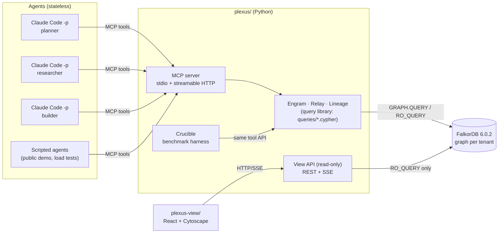

# Plexus: phased build plan

Status: **plan**, written 2026-10-14 before the window opens (notes are allowed under R5). **No code before Oct 15 00:16 NPT.**
Internal submit deadline: **Oct 18 20:00 NPT** (the official close is Oct 19 00:14 NPT).
Authoritative context: `CLAUDE.md` (rules), `docs/DECISIONS.md` (D-001…D-009), `docs/BASELINE.md` (evaluation), `docs/reference/FALKORDB_REFERENCE.md` (what FalkorDB 6.0.2 actually does).

---

## 0. What we're building: two projects, one repo

| Project | What it is | Tech | Talks to |
|---|---|---|---|
| **`plexus/`** (the product, the judged core) | FalkorDB + an **MCP server whose every tool is a deterministic, parameterised Cypher query**. Modules: **Engram** (memory), **Relay** (coordination), **Lineage** (provenance and time travel), plus **Crucible** (benchmark) and the **demo** runner (scripted and Claude Code agents). Also serves a small **read-only View API** for the second project. | Python 3.12 (uv), `falkordb` client (sync and asyncio), official `mcp` Python SDK, FastAPI (View API + SSE), fastembed (local CPU embeddings, 384-d) | FalkorDB 6.0.2 |
| **`plexus-view/`** (the demonstrator) | A web app that shows **what is stored in FalkorDB, how it flows in, and what the demo created**: graph explorer, live flow timeline, time machine, "why" path, data inventory, the Cypher behind each event, an ablation switch, and benchmark results | Vite + React + TypeScript, Cytoscape.js (fcose layout) for the graph. `@falkordb/canvas` will be evaluated in the P0 spike | Plexus View API only (HTTP + Server-Sent Events). **Never writes.** |

The FalkorDB Browser (`:3000`) stays available as a second, raw view for the video.



### Repo layout (monorepo)
```
falkordb/                      ← git root (repo name: plexus)
├── CLAUDE.md  README.md  docker-compose.yml  .env.example
├── plexus/
│   ├── pyproject.toml
│   ├── src/plexus/
│   │   ├── graph/      client.py (pool, ro/rw), tenancy.py (tenant→graph name), queries.py (loader), schema.py
│   │   ├── embed/      local embedding model wrapper (fastembed bge-small, 384-d, cosine)
│   │   ├── engram/     episodes, facts, scopes, recall, procedures
│   │   ├── relay/      tasks, deps, claims/leases, handoffs, decisions
│   │   ├── lineage/    why, why_recalled, who_knew, as_of, forget_source, (quarantine)
│   │   ├── audit/      ToolCall recording (inside each tool's own Cypher)
│   │   ├── mcp/        server.py: tool registry, transports, tenancy binding
│   │   └── api/        view_api.py (FastAPI, read-only) + SSE feed
│   ├── queries/        schema/ engram/ relay/ lineage/ view/ *.cypher  (header: purpose, params, returns)
│   ├── crucible/       backends/ (files, sqlite, vector, plexus), l1_correctness/, l2_questions/, l3_e2e/, l4_perf/, report.py
│   ├── demo/           scenario/ (software-team seed + task DAG + fault script), roles/ (prompts), orchestrator.py (claude -p), scripted.py, recorder.py, replay.py
│   └── tests/          unit/ integration/ contract/ (MCP), conftest.py (throwaway graph per test)
├── plexus-view/
│   ├── package.json  vite.config.ts
│   └── src/  api/ (typed client, SSE)  views/ (Explorer, Flow, TimeMachine, Why, Inventory, Results)  components/
└── docs/  PLAN.md DECISIONS.md BASELINE.md AI_USAGE.md graph-model.md queries.md reference/ research/
```

---

## 1. Principles (apply to every phase)

1. **FalkorDB is the only state store** (R2). There's no secondary DB, cache or JSON state in Plexus. Crucible's *baseline* backends are the only exception, by design.
2. **One MCP tool = one bounded, parameterised Cypher statement**, loaded from `queries/**.cypher`. No string-built Cypher, no LLM inside Plexus (D-002). Each write is atomic and bounded: explicit `UNWIND` sizes, and `LIMIT` before writes.
3. **Read with `ro_query`, write with `query`.** Nearest-first vector search is `ORDER BY score ASC`. No `datetime()`: times are epoch ms. "Open-ended" `valid_to` is the sentinel `OPEN = 9_999_999_999_999`, because null can't be stored. Maps are stored as `toJSON()` strings. (See the reference's §2 table.)
4. **Graph per tenant:** `plexus_t_<tenant>`, `[a-z0-9_]` only. Tests use `test_<uuid>`, deleted in teardown.
5. **TDD in vertical slices:** test → query file → Python wrapper → MCP tool. Commit each green slice.
6. **Isolation:**
   - each parallel subagent gets its own **git worktree + branch** and its **own FalkorDB container** on its own port;
   - never the shared `falkordb-dev`;
   - env vars inline, never `export` (D-005).
7. **Every phase ends green:**
   - `ruff check` and `ruff format --check` (Python);
   - `pytest` (unit + integration on throwaway graphs);
   - `npm run lint && npm run typecheck && npm test` (view);
   - `docker compose up` smoke (from P2);
   - an **independent reviewer subagent** on the phase diff.

   Only the orchestrator merges and edits this plan's status table.
8. **Disclosure and understanding (R7/R8):** append to `docs/AI_USAGE.md` every phase. The owner reviews the graph model, every `.cypher` file and the architecture. `docs/queries.md` indexes every query with one line explaining why it's a graph query.
9. **Synthetic data only.** The demo is a generic software team building a fictional service.

---

## 2. Graph model v1 (the shared contract; frozen at the end of P0, changed only by the orchestrator)

**Nodes** (every node has `id` (UUID string) and `created_at` (epoch ms); vectors are `vecf32`, 384-d, cosine):

| Label | Key properties | Module |
|---|---|---|
| `Agent` | `id, name, role, harness` | all |
| `Scope` | `id, kind: user\|project\|global, name` | Engram |
| `Session` | `id, agent_id, started_at, ended_at` | Engram |
| `Episode` | `id, role, text, at, step, embedding` | Engram |
| `Entity` | `id, name, norm_name (lower-cased, whitespace-collapsed; MERGE key), kind, embedding` | Engram |
| `Fact` | `id, subject_id, predicate, value, valid_from, valid_to(OPEN), recorded_at, status: active\|superseded\|quarantined\|forgotten, confidence, embedding` | Engram |
| `Source` | `id, uri, kind, trust` | Lineage |
| `Procedure` | `id, name, task_type, steps_json` | Engram |
| `Run` | `id, at, success, notes` | Engram |
| `Task` | `id, title, status: open\|claimed\|done\|failed, priority, lease_until, claimed_by, version, done_at` | Relay |
| `Handoff` | `id, at, note` | Relay |
| `Artifact` | `id, kind, uri, hash, summary` | Relay |
| `Decision` | `id, text, at` | Relay |
| `Step` | `id, n, at, agent_id` | Lineage |
| `ToolCall` | `id, tool, at, agent_id, query_name, run_time_ms, wrote` | audit (feeds the View) |
| `Recall` | `id, at, query, scope_id, agent_id, k` | Lineage (the record behind `why_recalled`) |

**Edges:**
- **Engram:**
  - `(Session)-[:HAS_EPISODE]->(Episode)-[:NEXT]->(Episode)`
  - `(Agent)-[:HAD]->(Session)`
  - `(Fact)-[:ABOUT]->(Entity)`
  - `(Fact)-[:DERIVED_FROM]->(Episode|Source|Fact)`
  - `(Fact)-[:IN_SCOPE]->(Scope)-[:INHERITS]->(Scope)`
  - `(Fact)-[:SUPERSEDES]->(Fact)`
  - `(Fact)-[:DUPLICATES|CONTRADICTS]->(Fact)`
  - `(Fact)-[:ASSERTED_BY]->(Agent)`
  - `(Procedure)-[:USED_IN]->(Run)-[:BY]->(Agent)`
  - `(Run)-[:FOR]->(Task)`
- **Relay:**
  - `(Task)-[:DEPENDS_ON]->(Task)`
  - `(Agent)-[:CLAIMED {at, lease_until}]->(Task)`
  - `(Handoff)-[:FROM]->(Agent)`, `(Handoff)-[:TO]->(Agent)`, `(Handoff)-[:FOR]->(Task)`, `(Handoff)-[:CARRIES]->(Artifact|Fact)`
  - `(Agent)-[:DECIDED]->(Decision)-[:BASED_ON]->(Fact)`
  - `(Decision)-[:FOR]->(Task)`
  - `(Artifact)-[:PRODUCED_BY]->(Agent)`
  - `(Artifact)-[:VERIFIED_BY]->(Agent)`
- **Lineage and audit:**
  - `(Recall)-[:RETURNED {rank, score}]->(Fact)`, `(Recall)-[:BY]->(Agent)`, `(Recall)-[:IN_STEP]->(Step)`
  - `(Step)-[:BY]->(Agent)`
  - `(Step)-[:READ]->(Fact)`, `(Step)-[:WROTE]->(Fact|Decision|Handoff|Task)`
  - `(Step)-[:NEXT]->(Step)`
  - `(ToolCall)-[:IN_STEP]->(Step)`
  - `(ToolCall)-[:CREATED|UPDATED]->(any)`

**Indexes and constraints** (`queries/schema/*.cypher`, idempotent):
- **Range indexes:** `id` on every label; `Entity(norm_name)`; `Fact(subject_id)`, `Fact(predicate)`, `Fact(valid_to)`, `Fact(status)`; `Task(status)`; `Step(n)`; `ToolCall(at)`.
- **Full-text:** `Entity.name`, `Fact.value`, `Episode.text`.
- **Vector** (384, cosine): `Entity.embedding`, `Fact.embedding`, `Episode.embedding`.
- **UNIQUE constraints:** `id` on `Task`, `Fact`, `Agent`, `Decision`, `Handoff`. Wait until the constraint reports `OPERATIONAL`.

## 3. MCP tool surface (target; contract tests pin names and schemas)

| Module | Tool | R/W | Graph work it does |
|---|---|---|---|
| Engram | `start_session`, `remember_episode` | W | append to an episode chain |
| | `assert_fact(subject, predicate, value, scope, source?)` | W | **one statement:** resolve entity (exact or vector) → close the current fact (`valid_to`, `SUPERSEDES`) or link `DUPLICATES`/`CONTRADICTS` → create the fact with provenance; returns conflicts |
| | `recall(query, scope, k, as_of?)` | R | vector seed → 1–2 hop expansion → scope inheritance and validity filter → ranked list with the `why` path |
| | `log_procedure_run`, `best_procedure(task_type)` | W/R | success-rate aggregation |
| Relay | `create_tasks(dag)` | W | `UNWIND` tasks + `DEPENDS_ON` |
| | `claim_next_task(agent, lease_ms)` | W | **one statement:** ready task (no open dependency) + expired-or-free lease → claim |
| | `heartbeat`, `complete_task`, `fail_task` | W | lease and version update |
| | `handoff(task, to, artifacts, facts, note)` | W | `Handoff` node + `CARRIES` |
| | `record_decision(task, text, based_on[])` | W | `Decision` + `BASED_ON` |
| | `blocked_by_failure(task)` | R | downstream `DEPENDS_ON*` traversal |
| Lineage | `why(decision\|fact)` | R | variable-length path to facts → agents, steps, sources |
| | `why_recalled(recall_id)` | R | the path recorded for a recall |
| | `who_knew(fact)`, `knew_at(agent, step)` | R | `READ` edges + validity windows |
| | `as_of(subject, predicate, t)` | R | validity-window query |
| | `forget_source(source)` | W | `DERIVED_FROM*` cascade → `status: forgotten` |
| | `quarantine(source)` *(stretch)* | W | blast radius: facts → agents that read them → decisions |

Every tool also creates a `ToolCall` (with `CREATED`/`UPDATED` edges) **inside the same statement**. That is how the View shows the flow, and it costs no extra round trip.

**MCP transports:**
- **stdio** for local Claude Code (`plexus.mcp.json`);
- **streamable HTTP** for the public endpoint.

The tenant is bound per connection (CLI arg or env for stdio, header or path for HTTP); agents never pass a graph name (D-009).

## 4. View API (read-only; consumed by `plexus-view`)

| Endpoint | Returns | Backing query |
|---|---|---|
| `GET /api/tenants` | the tenant graphs | `GRAPH.LIST` filtered by `plexus_t_` |
| `GET /api/{t}/inventory` | counts per label and per edge type, property keys, index list | `queries/view/inventory.cypher` + `db.indexes()` |
| `GET /api/{t}/graph?labels=&since=&until=&limit=` | nodes and edges for the explorer (capped) | `queries/view/subgraph.cypher` |
| `GET /api/{t}/flow?after=` | ordered `ToolCall`s with created/updated node IDs, query name, `run_time_ms` | `queries/view/flow.cypher` |
| `GET /api/{t}/stream` (SSE) | new `ToolCall`s as they land (poll ~500 ms server-side, push to clients) | same |
| `GET /api/{t}/step/{n}` | what each agent knew and wrote at step *n* | `queries/view/knew_at.cypher` |
| `GET /api/{t}/why/{id}` | the path(s) for a decision or fact | `queries/lineage/why.cypher` |
| `GET /api/queries/{name}` | the Cypher text of a named query, for the "Cypher behind this" panel | file read |
| `GET /api/results` | Crucible results JSON | file read |

---

## 5. Phase table (the orchestrator updates the Status column only after the gate passes)

| Phase | Target (NPT) | Parallel work (agent → worktree / DB port) | Status |
|---|---|---|---|
| **P0** Kickoff and foundations | Oct 15 00:16 → ~05:00 | orchestrator; spike agents S1 (MCP + Claude Code), S2 (embeddings on Windows/Linux), S3 (view graph library) | ✅ core 88d09c0; S1/S2/S3 ✅ (25e7b78) |
| **P1** Engram core ‖ Relay core ‖ View shell | Oct 15 → Oct 15 night | A Engram (`wt-engram`, :6381) · B Relay (`wt-relay`, :6382) · C View shell on fixture data (`wt-view`) | ✅ A+B merged f3a428e; review found 2 blockers → P1-fix merged; C view shell merged 4e867e3 (65 view tests) |
| **P2** Lineage ‖ MCP server + View API | Oct 16 | D Lineage (`wt-lineage`, :6383) · E MCP server + audit + View API (`wt-mcp`, :6384) | ✅ D+E merged 059cdaf; P2-int merged 1271d7b (328 tests; compose up + MCP HTTP + View API verified end-to-end) |
| **P3** Demo scenario + agents ‖ View features | Oct 16 eve → Oct 17 | F Demo runner + scenario + recordings (`wt-demo`, :6386) · G View features (`wt-view2`) | ✅ F merged 50bf55e (real Sonnet 3-agent recording: 83 steps, kill→reclaim, v1→v2 supersede, 0 denials, $0.70); G merged ce29cca (117 view tests, live screenshots); compose walkthrough + reviewers in P5 |
| **P4** Crucible benchmark | Oct 17 | H backends + L1 + L4 (`wt-cru1`, :6389) · I L2 questions + runner (`wt-cru2`, :6378) | ✅ L1 0 violations all arms; L4 (SQLite faster on median claims; Plexus +73% across tenant graphs); ablation 7/7; L2 43q tie (P/B0/B1 43, B2 40); pre-registered L2-scale 36q: P 36, B1 32, B0 30, B2 23 |
| **P5** Integration, hardening, review → **READY FOR TESTING** | Oct 17 night → Oct 18 ~10:00 | 3–4 disjoint reviewers → fix agents; stretch work only if green | ✅ **READY FOR TESTING**: 4 reviews → 3 fix branches + P5-int merged; 869 Python + 150 View tests; fresh-clone `docker compose up` e2e verified; DoRT evidence and owner checklist in `docs/TESTING.md` (DoRT 3 and 5 partly met, see Known gaps) |
| **P6** Deploy + submission | Oct 18 10:00 → 20:00 | orchestrator + owner (video, submission form) | ✅ agent work done: deploy image verified at 512 MB (332 MiB peak, 40/40 checks), `render.yaml` + `docs/deploy.md`; README, `docs/VIDEO_SCRIPT.md` (2:50), `docs/BLOG_DRAFT.md`, `scripts/verify_readme.py` (277 checks). **Owner:** push a public repo, create the Render service, fill `<RENDER_URL>`/`<VIDEO_URL>`, record the video, review the _TBD_ rows in AI_USAGE, submit by Oct 18 20:00 NPT |
| **P7** Memory that notices change (staleness + re-verify) ‖ activation-based forgetting  ✅ J 6c66261, K ad6f85c, L e70ec96, int 9501539; review 14 findings → fix-p7 c087c3e. 41 tools. L5a symbol anchors exact; L5b default floor 0.5 failed pre-registration → 0.9 confirmed (0 critical loss, recall@5 96.4%). Real physio run recorded. Compose smoke green |
| **P8** Structure and readability pass (no behaviour change) | Oct 16 | a MCP layer (`wt-p8a`, :6395) · b services/API/CLI (`wt-p8b`, :6396) · c Crucible/demo (`wt-p8c`, :6397) · d viewer (`wt-p8d`) → reviewer  ✅ a c922dcb (ToolTable; 521-line closure → flat tools), b fabc4c3 (plexus.common, API routers, parser split), c 01e90ac (l1 plumbing, backends/base, report writers), d 52b2ffc (graphController/Results/Explorer split). Snapshot, API schema and viewer HTML byte-identical; 1229 Python + 223 view tests; PLEXUS_REPORT.md updated |
| **P9** Beat-SQL question + the three product fixes | Oct 16 | a Crucible B1h + L6 (`wt-p9a`, :6361) · b traversal/impact/relations (`wt-p9b`, :6362) · c dedup (`wt-p9c`, :6363) · d entity resolution (`wt-p9d`, :6364) · e audit modes (`wt-p9e`, :6365) → P9-int (`wt-p9int`, :6366) | ✅ all merged (b0318b2, 85d27cf, 467f362, 0c5a8bc, af122ae, efc1c49). B1h ties L2 43/43 and L2-scale 36/36; L6 A/B/D/E tie with hand-written SQL, F lost (94/1,240 orphans) then fixed (0/1,842); pilot $7.09. 45 tools, 108 queries, 1512 Python + 229 view tests. C7 extended: 0 false merges/150. 50-racer entity test 20/20. Audit modes with no-write proof |
| **P10** Graph vs SQL strengths by scale (Crucible L7: G multi-tenancy, H expressiveness/traversal, I atomic writes, J session populations) | Oct 16 | branch `p10` (`wt-p10`, :6364/:6365/:6367/:6368/:6369), not merged | ✅ pre-registered (`docs/research/P10_GRAPH_VS_SQL.md`, amendments 1-4), all four families run, verdict: expressiveness refined, traversal write-confirmed/run-refuted, multi-tenancy refined, atomic writes confirmed (refined by single-statement Cypher) |

### P0: Kickoff and foundations (orchestrator-led)
**Build**
1. `git init`, `.gitignore`, MIT `LICENSE`, `README.md` stub. First commit after 00:16 NPT (R5 evidence).
2. `docker-compose.yml`: `falkordb` pinned (verify `falkordb/falkordb:6.0.2` or pin the digest).
   - `REDIS_ARGS="--appendonly yes --maxmemory-policy noeviction"`
   - `FALKORDB_ARGS="TIMEOUT_MAX 10000 TIMEOUT_DEFAULT 5000 MAX_QUEUED_QUERIES 500 RESULTSET_SIZE 100000 QUERY_MEM_CAPACITY 268435456"` (verify each name against the C reference §2)
   - a healthcheck
   - service stubs for `plexus-mcp`, `plexus-api` and `plexus-view`
3. `plexus/` uv project:
   - `graph/client.py`: sync and async pools, `ro()`/`rw()`, per-call timeout;
   - `graph/tenancy.py`;
   - `graph/queries.py`: loads `.cypher` files with header parsing, fails on missing parameters;
   - `graph/schema.py`: applies `queries/schema/*` idempotently and waits for constraints;
   - `tests/conftest.py`: throwaway graph per test, ports from `PLEXUS_TEST_DB_PORT`;
   - ruff + pytest configuration.
4. `docs/graph-model.md` (mermaid + tables from §2), `docs/AI_USAGE.md`, `docs/queries.md` skeleton.
5. Per-agent DB helper: `scripts/agent_db.sh <slot>` → `docker run -d --name plexus-db-<slot> -p 127.0.0.1:63<slot>:6379 <pinned image>`.

**Spikes** (subagents, throwaway, findings written to `docs/spikes/*.md`):
- **S1:** minimal Python MCP server with one tool, called by `claude -p --mcp-config` on this machine over stdio *and* streamable HTTP. Record the exact config and flags.
- **S2:** `fastembed` bge-small on Windows + in the Linux container. Record its size, load time and vectors/sec.
- **S3:** Cytoscape.js vs `@falkordb/canvas` for about 2k nodes with live updates. Pick one.

**Gate:** lint clean; `pytest` green (schema applies twice idempotently; all constraints `OPERATIONAL`; the loader rejects missing parameters); `docker compose up falkordb` healthy; spike reports present; the owner reviews graph model v1 → **freeze**.

### P1: Engram core ‖ Relay core ‖ View shell (3 parallel agents)
- **A Engram:**
  - episodes and sessions;
  - entity resolution (exact → full-text → vector, with a threshold);
  - `assert_fact` (supersede, duplicate and contradiction in one statement);
  - scopes with inheritance;
  - `recall` (hybrid, budgeted, `as_of`);
  - `log_procedure_run` and `best_procedure`.

  Python service functions only, no MCP yet. Tests: supersede chain, as-of correctness, scope isolation, contradiction detected, paraphrase duplicate linked, budget respected.
- **B Relay:**
  - `create_tasks` (DAG via `UNWIND`);
  - `claim_next_task` (single-statement compare-and-set honouring dependencies and leases);
  - heartbeat, complete and fail;
  - handoff, record_decision, `blocked_by_failure`.

  Tests: 50 threads × 200 tasks → 0 double claims; expired lease is reclaimed; dependency order respected; version conflict rejected.
- **C View shell:** Vite/React/TS app, routing, typed API client generated from §4, layout, and an Explorer rendering **fixture JSON** shaped exactly like the View API. Lint, typecheck and a component test.

**Gate:** each branch green alone → merge A, B, C (`--no-ff`) → full suite green → reviewer on the merged diff → fixes → commit.

### P2: Lineage ‖ MCP server + audit + View API (2 parallel agents)
- **D Lineage:**
  - `Step` recording helpers;
  - `why`, `why_recalled`, `who_knew`, `knew_at`, `as_of`, `forget_source`.

  Tests on a seeded mini-scenario with known answers.
- **E MCP + audit + View API:**
  - MCP server registering every Engram, Relay and Lineage tool with JSON schemas;
  - tenancy binding per connection;
  - `ToolCall` creation embedded in each write query (a shared Cypher fragment convention);
  - stdio + HTTP transports;
  - FastAPI View API + SSE (read-only, `ro_query` only);
  - `plexus.mcp.json`.

  Contract tests pin the tool list and schemas.

**Gate:** suite green; `docker compose up` → MCP HTTP and View API healthy; **Claude Code headless smoke** (`claude -p` with the MCP config) calls `remember_episode`, `assert_fact`, `recall`, `claim_next_task` and `why` successfully on a throwaway tenant; reviewer pass.

### P3: Demo scenario + agents ‖ View features (2 parallel agents)
- **F Demo:**
  - **Scenario "Acme Notes API":** a fictional team builds a small notes REST service spec. Seeds: about 12 tasks in a DAG, 3 roles (planner, researcher, builder), synthetic docs as `Source`s.
  - **Fault script:** kill the builder at step ~15; the researcher supersedes "API version = v1 → v2" at step ~20; a conflicting "auth = JWT" vs "auth = API key" is asserted; one poisoned source (stretch).
  - `orchestrator.py` runs 3 `claude -p` processes (D-002 flags, `--max-turns`, stream-json logs) against a fresh tenant.
  - `recorder.py` snapshots the tenant (`GRAPH.COPY`) + transcripts → `demo/recordings/<run>/`.
  - `replay.py` restores a recording for the public demo.
  - `scripted.py` provides deterministic non-LLM agents (public demo + load).
  - Pilot one real run and record usage.
- **G View features:**
  - **Explorer:** filter by label, edge or time; colour by module.
  - **Flow:** live `ToolCall` timeline via SSE; click an event → the nodes it created light up + the Cypher text.
  - **Time Machine:** step slider → what each agent knew and wrote.
  - **Why:** path highlight.
  - **Inventory:** "what data the demo created", counts and examples per label and edge.
  - **Tenant switch.**
  - **Ablation toggle:** a read-only *simulation* that drops relationship types from the view and shows which tool queries would fail. The real ablation runs in Crucible.

**Gate:** a real recorded run exists, and the replay reproduces identical inventory counts; the View works end to end against live compose; owner walkthrough; reviewer pass.

### P4: Crucible (2 parallel agents; see `docs/BASELINE.md`)
- **H:**
  - backends B0 files (with locks), B1 SQLite, B2 vector, P Plexus, all implementing **the same Python tool interface**;
  - L1 tests C1–C8;
  - L4 performance;
  - runs inside the compose network via a `crucible` service;
  - results JSON + `crucible/report.md`.
- **I:**
  - the L2 scenario recording per arm (scripted where possible);
  - about 40 exact-match questions in 11 families;
  - the QA runner: Plexus = Cypher; baselines = the same LLM through `claude -p` with an equal budget;
  - the results table.
- **L3 end-to-end:** stretch; pilot only, if usage allows.

**Gate:** reproducible `make bench` (or `uv run crucible all`); results committed with config + seeds; the View "Results" page reads them; honesty rules in BASELINE §6 checked.

### P5: Integration, hardening, review → **READY FOR TESTING**
1. Fresh clone → `docker compose up` → seed → demo replay → View works. Run it on a second clean checkout.
2. Whole-build review by **4 disjoint reviewers**:
   - (a) Cypher/queries: correctness, bounds, injection, index use via `GRAPH.EXPLAIN`;
   - (b) concurrency and tenancy;
   - (c) MCP + API surface and errors;
   - (d) View + test-suite quality.

   Then a fix agent per scope with explicit file ownership.
3. Ablation demo script (real): restart Plexus with a guard that strips `DEPENDS_ON`, `BASED_ON`, `DERIVED_FROM` and `READ`; show the failures.
4. Stretch, only if everything is green: `quarantine`, L3 runs, procedures UI.
5. Freeze the features. **Definition of Ready for Testing (DoRT)**, all true:
   - [ ] `docker compose up` from a clean clone works with no manual steps beyond `.env`;
   - [ ] the suite is green (Python + View), lint clean, and the reviewers' findings are fixed or logged;
   - [ ] every MCP tool is callable from Claude Code headless and has a contract test;
   - [ ] the demo replay and the live scripted demo both run; one real Claude Code recording exists;
   - [ ] Crucible L1, L2 and L4 results are reproducible from one command;
   - [ ] the View shows Explorer, Flow, Time Machine, Why, Inventory and Results against live data;
   - [ ] `docs/queries.md` lists every query; `docs/graph-model.md` matches the schema files;
   - [ ] the owner's manual test checklist (§7) is handed over.

### P6: Deploy + submission
- **Deploy (D-006):**
  - Render Free, one container: FalkorDB + `plexus-api` + MCP HTTP + the static View;
  - reseed from a recording on boot;
  - uptime ping;
  - **no LLM runs on the public site** (D-003).
- **README:**
  - pitch;
  - architecture;
  - **graph data model**;
  - **query index**;
  - setup (local compose);
  - track: **Track 02**;
  - "why FalkorDB is the core", plus the ablation;
  - benchmark results + methodology limits;
  - AI disclosure.
- **Demo video (≤ 3 min, owner records):**
  1. problem (Claude Code/Hermes gaps, first-hand);
  2. live Flow while agents work;
  3. kill an agent → its work is reclaimed;
  4. supersede and contradiction;
  5. Time Machine "what did the builder know at step 12";
  6. "why did we choose v2" path;
  7. tenant isolation;
  8. benchmark slide;
  9. ablation.
- Blog draft (side prize). Submit by **20:00 NPT**, then freeze.

---

### P7: Memory that notices change ‖ activation-based forgetting (D-011, D-012)
Research: `docs/research/forgetting-A-science-and-papers.md` (cognitive science and papers, 40 sources),
`docs/research/forgetting-B-products.md` (products and graph databases, 69 sources).

**Graph model v1.1 (additive; no existing field changes meaning)**
- `Fact` gains:
  - `verify_state` (`verified` | `suspect`), `suspect_since`, `verified_at`, `verify_after` (optional; `OPEN` when unset);
  - `surprise` (0–1, set once at write time) and `pinned`.
- New status `dormant` (only set by an explicit sweep; can be restored).
- `Source` gains `kind` (`code` | `doc` | `external`), `content_hash`, `commit`, `repo`, and `trust` (`normal` | `high`).
- New nodes:
  - `CodeAnchor {id, repo, path, symbol, hash, updated_at}`;
  - `Change {id, commit, at, paths, agent_id}`.
- New edges:
  - `(Fact)-[:ANCHORED_TO]->(CodeAnchor)`;
  - `(Source)-[:DESCRIBES]->(CodeAnchor)`;
  - `(Change)-[:TOUCHED]->(CodeAnchor|Source)`;
  - `(Change)-[:SUSPECTED]->(Fact)`;
  - `(Fact)-[:VERIFIED_BY {at, commit, outcome}]->(Agent)`.
- `READ` gains `{via: 'recall'|'use', at}`.
- Indexes: `CodeAnchor.path`, `Change.at`, `Fact.verify_state`.

**J — Staleness (Plexus server, TDD, own DB slot)**
1. Schema v1.1 plus migration: existing facts get `verify_state='verified'` and `surprise=0`, and `READ` edges without
   `via` count as `recall`.
2. `anchor_fact(fact_id, path, symbol?, hash)` and `describe_code(source_id, path, symbol?, hash)`. `assert_fact` and
   `add_source` take an optional `anchor`. A `Source` whose uri is a repo path implicitly anchors its derived facts at
   file level, which is the zero-effort path for existing graphs.
3. `mark_changed(changes=[{path, symbol?, old_hash?, new_hash}], commit?, at?)`:
   - **one bounded statement:** update anchors, create the `Change`, then mark the facts linked to changed anchors
     (direct, or via the source file) `suspect` with `SUSPECTED` edges;
   - **unchanged hashes are a no-op**, so the call is idempotent;
   - **returns** the facts marked suspect, the affected decisions (via `BASED_ON`), and the docs that describe the
     changed code (via `DESCRIBES`).
4. `verify_fact(fact_id, still_true, new_value?, evidence?)`:
   - **confirmed:** set `verified` and add a `VERIFIED_BY` edge;
   - **changed:** run the supersede path with the old fact's `valid_to` = the `Change.at` that made it suspect (event
     time) while `recorded_at` stays now; then flag the dependent decisions as `needs_review`, as forget does.
5. `facts_to_verify(scope?, limit)`: suspect facts plus facts whose `verify_after` has passed, ordered by number of
   dependent decisions, then activation. `docs_to_update(since?)`: doc sources that `DESCRIBES` code changed since
   their last verification.
6. `recall` result rows gain `verify_state`, `suspect_since` and `suspect_reason`. Suspect facts are still returned and
   never silently dropped.
7. **Client CLI** (runs on the user's machine, not in Docker): `plexus code-scan --repo . --tenant t [--commit HEAD]`.
   - It hashes files, plus Python functions and classes via `ast`, and calls `mark_changed` over MCP HTTP.
   - `plexus hook claude` prints the `PostToolUse` (Edit|Write|MultiEdit) hook JSON for `.claude/settings.json`.
   - `plexus hook git` installs `post-commit`.
   - TS/Dart symbols: file-level only, with tree-sitter as a stretch.

**K — Activation-based forgetting (Plexus server, TDD, own DB slot)**
1. Write time:
   - `assert_fact` computes `surprise`: supersede 0.6, cross-agent contradiction 0.9, otherwise novelty
     `1 − max_cos` from the duplicate check's neighbours (capped at 0.5), and a duplicate gets 0;
   - `READ` edges written by `record_recall` get `via:'recall'`; uses (`BASED_ON`, `CARRIES`, assert-time reads) count
     as `use`.
2. `queries/engram/activation.cypher`: for a list of fact ids, compute
   `A = ln Σ w·max(Δt, 60 s)^-0.5` over the last 50 events, plus surprise pseudo-accesses and protection flags.
   Benchmark the cost at 10k facts × 50 events.
3. `recall` re-ranks: `final = relevance × (0.5 + 0.5·σ(A − A₀))`, where protected facts get ≥ neutral and exact
   keyword matches bypass the penalty. A `forgetting: on|off` parameter is kept for the ablation. As-of, why, knew_at
   and fact_history ignore activation.
4. `pin_fact` / `unpin_fact`; `memory_strength(fact_id)` explains A (events, weights, surprise, protection);
   `memory_sweep(threshold, dry_run=true)` → `dormant` (unprotected facts only); `restore_fact`.
5. The rate parameter d, A₀, the floor and K are environment settings with defaults; the defaults are documented as
   design choices, not validated values.

**L — Viewer + docs**
- Viewer: a "suspect" badge and a "faded" opacity driven by activation; Inventory counts suspect, dormant and pinned
  facts; a "Needs verification" list.
- Docs:
  - `docs/mcp.md`: the new tools;
  - `docs/graph-model.md` v1.1;
  - `docs/queries.md`: the new `.cypher` files with their "why it's a graph query" notes;
  - README: a "Memory that notices change" section.

**Crucible L5 (pre-registered before any run, as for L2-scale)**
- **Staleness:** a scripted repo of 20 commits and 60 anchored facts. Measure the precision and recall of
  `mark_changed` against ground truth for file-level vs symbol-level anchors, and stale facts returned unflagged
  (target 0; the baseline without anchors misses every one).
- **Forgetting:** the L2-scale history with decaying noise added. Measure recall@k, the share of returned facts that
  are noise, and tokens per recall, with forgetting on vs off, plus a "rarely used but critical" probe set
  (decision-supporting facts read once, 90 days ago). Pass criteria:
  - no loss of the critical probes;
  - noise reduced;
  - accuracy reported honestly even if unchanged.

**Real-run check:** run Claude Code against the physio copy (`physio_test`) in a scratch clone of `pv-core-api`:
1. edit `create_gateway_payment`;
2. the hook marks the payment facts suspect;
3. Claude re-verifies;
4. supersede at the change time, and the README section is listed in `docs_to_update`.

**Gate:** lint clean; all existing tests plus the new ones green; L5 results committed; real run recorded; independent
review (queries + concurrency of `mark_changed` against concurrent `assert_fact`); the owner reviews D-011/D-012 and the
v1.1 model.

**Cut order if time is short:**
1. symbol-level anchors (keep file level);
2. `memory_sweep`/`dormant`;
3. Hebbian co-access (not planned);
4. viewer polish.

Never cut: suspect → verify → supersede at the change time, query-time activation in recall, and protection of facts
that decisions are based on.

## 6. Risks and mitigations

| Risk | Mitigation |
|---|---|
| Too much scope for 4 days | Hard cut order: stretch → UI polish → L3; the MVP is never cut. Daily check against the phase table at 08:00 and 20:00 NPT. |
| Claude Code headless + MCP quirks on Windows | S1 spike in P0; fallback to scripted agents for every scene except the recording. |
| Subscription usage runs out | Pilot first; Sonnet/Haiku; `--max-turns`; L2/L3 baselines use small budgets; replays for the public demo. |
| Write serialisation per graph limits throughput | One statement per tool; spread hot tenants over graphs; L4 measures and reports the ceiling honestly. |
| FalkorDB doc vs 6.0.2 mismatches | Design from the reference's "verified" column; throwaway graphs; per-agent containers. |
| Shared-server crash (it already happened once) | Per-agent containers; AOF on; bounded writes; `QUERY_MEM_CAPACITY`. |
| Render 512 MB / sleep | Measure the container's RSS in P5; fallback hosting per D-006. |

## 7. Owner manual test checklist (handed over at the end of P5)

1. Run `docker compose up` from a clean clone. Open the View, then the FalkorDB Browser.
2. Run `uv run plexus demo replay acme-notes`. Then:
   - Inventory shows the expected counts;
   - Explorer renders.
3. Run `uv run plexus demo live --scripted`. Then:
   - Flow streams `ToolCall`s live;
   - clicking an event shows the nodes it created and the Cypher behind it.
4. Kill the builder agent mid-run. Its task is reclaimed after the lease expires, and the Flow shows the reclaim.
5. Time Machine: open step 12, then step 25. The builder's belief about the "API version" changes from v1 to v2.
6. Why: on decision "use v2 endpoints", the path shows facts → researcher → step → source.
7. Tenant switch: a second tenant shows none of tenant A's data. The API returns 0 rows for A's IDs.
8. Run `uv run crucible all --quick`. The Results page shows L1 (0 violations for P), the L2 accuracy table and L4 latency.
9. Connect your own Claude Code to the MCP (stdio config in the README). Ask it to `recall` and `why`.
10. Ablation script: the listed features fail with clear errors.
