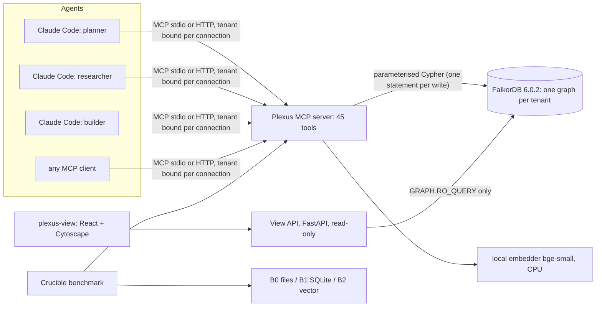

# Plexus: the full report

**One shared graph brain for AI agent teams.** Graph Hacks (WeMakeDevs × FalkorDB), **Track 02: Agent Memory and
Coordination**.

This one document covers:
- the problem;
- the method we used to build and measure Plexus;
- why FalkorDB is the core of it rather than a storage detail;
- what we found;
- what is still weak.

Every number below comes from a file in this repo. The source is named next to each claim, so it can be checked.

---

## Contents

1. [Problem statement](#1-problem-statement)
2. [What Plexus is](#2-what-plexus-is)
3. [How FalkorDB is the core](#3-how-falkordb-is-the-core)
4. [Methodology: how it was built](#4-methodology-how-it-was-built)
5. [Methodology: how it was measured (Crucible)](#5-methodology-how-it-was-measured-crucible)
6. [Findings](#6-findings)
7. [Memory that notices change, and forgetting (P7)](#7-memory-that-notices-change-and-forgetting-p7)
8. [Can a graph beat SQL? (P9)](#8-can-a-graph-beat-sql-p9)
9. [Shortcomings and limits](#9-shortcomings-and-limits)
10. [What we would do next](#10-what-we-would-do-next)
11. [Where to find everything](#11-where-to-find-everything)

---

## 1. Problem statement

### 1.1 The track's brief

> "Build agents that remember across sessions and share state with each other. Memory should persist, update over time,
> and be available to every agent that needs it."

The brief's focus areas:
- episodic, semantic and procedural memory;
- persistent conversation history;
- shared state and handoffs between agents;
- high-concurrency reads and writes;
- separate memory per user or tenant.

### 1.2 How today's agents remember and coordinate

We surveyed coding agents, memory layers and multi-agent frameworks. The cited survey is in
`docs/research/landscape/1-agent-products.md`, `2-memory-layers.md` and `3-coordination.md`. The common pattern:

| Product | How it remembers | Documented limits |
|---|---|---|
| **Claude Code** | `CLAUDE.md` hierarchy plus auto-memory as Markdown files in `~/.claude/projects/<project>/memory/`, machine-local | Index capped at 200 lines / 25 KB; conflicting rules are picked "arbitrarily" (Claude Code memory docs) |
| **Hermes Agent** | `MEMORY.md` (2,200 chars) + `USER.md` (1,375 chars), SQLite FTS5 session search, skills | Hard character caps; global memory with no project or tenant boundary |
| **Mem0, Letta, Graphiti, Zep** | Vector + entity stores, shared memory blocks, temporal knowledge graphs | Concurrent-writer races (Mem0 issue #6515), last-writer-wins shared blocks (Letta), invalidation decided by an LLM and inconsistent (Graphiti issue #1841) |
| **Claude Code agent teams, Hermes subagents, CrewAI, LangGraph** | A task list or kanban plus self-reported summaries from subagents | Handoffs and decisions are free text, not queryable objects |

### 1.3 The eight gaps

These gaps come from `docs/research/PROJECT_IDEAS.md`. Each is cited in the landscape files.

| # | Gap | What goes wrong |
|---|---|---|
| **G1** | **Handoffs, claims and decisions aren't first-class, queryable objects** | Subagents return self-reported summaries. No product or benchmark models `Task`, `Handoff` or `Decision` as data, so "who handed what to whom, based on what?" can't be answered. |
| **G2** | **No consistency story for concurrent writers** | Duplicates are created in races, the last writer wins, and the documented advice is "designate one owner". |
| **G3** | **No temporal validity** | A stale fact stays "current" next to its replacement. When invalidation exists, an LLM decides it inconsistently. |
| **G4** | **Memory isn't scoped** | Memory is global or per repo, with no tenant, project or agent boundary. |
| **G5** | **No conflict detection between agents' facts** | Two agents assert opposite things and nobody notices. A 2026 position paper (arXiv 2603.10062) says memory consistency "has not been formally defined and no framework detects violations". |
| **G6** | **Provenance and "why was this recalled" are partial or missing** | Precise forgetting and containing poisoned memory become impossible. MAPLE-Guard shows one poisoned write promoted into shared memory contaminates agents that never saw the attack; gating cut attack success from 38.2% to 0.9%. |
| **G7** | **Procedural memory doesn't learn from outcomes** | Skills are counted by usage, not by success. |
| **G8** | **No benchmark covers concurrency, handoffs, tenant leaks or invalidation** | LoCoMo, LongMemEval and MemoryAgentBench test recall over dialogue. LoCoMo itself was audited to contain 99 score-corrupting answer-key errors (6.4% of 1,540). |

The MAST failure taxonomy (Cemri et al., arXiv 2503.13657; 1,600+ traces from 7 frameworks) puts numbers on G1, G3 and G5.
The largest failure modes are:

| Failure mode | Share of failures |
|---|---|
| Step repetition (duplicated work) | 15.7% |
| Reasoning–action mismatch | 13.2% |
| Missing completion recognition | 12.4% |

### 1.4 First-hand evidence from building this project

We saw several of these gaps while building Plexus with a multi-agent setup (Hermes orchestrating Claude subagents):

- **G2/G4 in practice:**
  - an exported `DATABASE_URL` leaked between parallel subagents and broke isolation;
  - later, a subagent's runaway write killed the shared FalkorDB container, and about 20 minutes of other agents'
    data was lost (`docs/DECISIONS.md` D-005).
- **G1 in practice:** parallel subagents returned only self-reported summaries. The orchestrator had to re-verify every
  claim, re-run every test gate and read every diff before merging.
- **G3 in practice:** the orchestrator's own memory still said "Docker is broken" after Docker had been fixed. Two
  contradictory notes sat side by side, with nothing to say which was current.
- **G4 in practice:** notes about an unrelated project (an HR payroll backend) were injected into this project's
  context, because the memory was global.

### 1.5 The problem in one sentence

> A team of AI agents has no shared memory that knows **what is true now**, **what changed and when**, **who knew what
> when they acted**, and **why a decision was made**. It also has no way to share work without stepping on itself when
> agents crash or race.

---

## 2. What Plexus is

### 2.1 In one paragraph

Plexus is a service that agents connect to over **MCP** (Model Context Protocol). It exposes **45 tools**. Each tool is
**one deterministic, parameterised Cypher query** (or a short fixed sequence of them) against a **FalkorDB graph per
tenant**:
- every memory, task, claim, handoff and decision is a node;
- every "because" (based on, derived from, depends on, supersedes, read, wrote) is an edge.

Plexus contains **no LLM and holds no LLM credentials**. The agents are unmodified Claude Code processes, and any MCP
client can connect. Semantic matching uses a small local embedding model (`BAAI/bge-small-en-v1.5`, 384 dimensions,
via fastembed, int8 ONNX on CPU), so it needs no API key and has no running cost.

### 2.2 Modules

| Module | Purpose | Gaps it targets | Main tools |
|---|---|---|---|
| **Engram** | Memory: episodic (sessions → episode chains), semantic (scoped facts about entities with validity windows), procedural (procedures → runs with success rates) | G2, G3, G4, G5, G7 | `start_session`, `remember_episode`, `assert_fact`, `recall`, `fact_history`, `log_procedure_run`, `best_procedure` |
| **Relay** | Coordination: dependency-aware atomic claims with leases, heartbeats, complete/fail with version checks, handoffs carrying artifacts and facts, decisions linked to their evidence | G1, G2 | `register_agent`, `create_tasks`, `claim_next_task`, `heartbeat`, `complete_task`, `fail_task`, `reopen_task`, `handoff`, `verify_artifact`, `record_decision`, `ready_tasks`, `task_status`, `blocked_by_failure` |
| **Lineage** | Provenance and time: steps per agent, READ/WROTE edges, recall records, "why", "who knew", "what did X know at step N", "as of T", forgetting by source, quarantine | G6 | `add_source`, `why`, `why_recalled`, `who_knew`, `knew_at`, `as_of`, `forget_source`, `quarantine_source`, `release_quarantine` |
| **Staleness** (P7) | Memory that notices change: facts anchored to files and Python symbols become **suspect** when the code changes (a Claude Code hook or git hook reports hashes); the agent re-verifies and the old fact is closed at the change's time | G3 (code ↔ memory drift) | `anchor_fact`, `describe_code`, `mark_changed`, `verify_fact`, `facts_to_verify`, `docs_to_update`, `set_review_date`; CLI `plexus code scan\|baseline\|hook-claude\|hook-git` |
| **Forgetting** (P7) | Activation-based ranking (ACT-R power-law decay over the use history already in the graph) with write-time surprise; facts fade in rank, never deleted; decision-supporting facts protected | memory hygiene (noise, growth) | `pin_fact`, `unpin_fact`, `memory_strength`, `memory_sweep` (dry-run, reversible), `restore_fact`; `recall(forgetting=…)` |
| **Relations + impact** (P9) | Typed entity relations (`assert_relation`, `RELATES`) with `recall(hops)`; a read-only `impact` tool: blast radius of a source, fact or task (facts, readers, decisions, handoffs, blocked tasks) with timestamps | multi-hop recall; impact before quarantine | `assert_relation`, `impact`, `recall(hops=…)` |
| **Dedup confirm** (P9) | Deterministic duplicate guards (numbers, units, negation, comparatives), a Jaccard tier, and `DUPLICATES_MAYBE` soft links an agent confirms or rejects | G5 precision | `confirm_duplicate`, `reject_duplicate` |
| **Audit** | Every tool call becomes a `ToolCall` node linked to its step and to every node it created or updated; audit modes `off\|light\|full` per tenant (public demo tenants are readable with zero writes) | feeds the viewer; makes the system observable | (automatic; `audit` arg on read tools) |
| **Crucible** | The benchmark: the same tool API over four backends, then correctness, provenance, end-to-end and performance layers | G8 | `crucible` CLI |
| **plexus-view** | A read-only React + Cytoscape viewer: Explorer, Flow, Time Machine, Why, Inventory, Results | makes the memory visible | (web UI) |

### 2.3 Architecture

### 2.4 Tenancy and safety

- **Tenant binding:** the tenant is bound **per connection**: `--tenant` for stdio, or the URL path `/mcp/t/<tenant>`
  for HTTP. It is never a tool argument, so an agent can't address another tenant's graph.
- **Graph names:** `plexus_t_<tenant>` with `^[a-z0-9_]{1,48}$`.
- **HTTP sessions** are pinned to the tenant that created them. A replayed session id under another tenant is
  refused, and pinning fails closed (an unknown session id gets 404).
- **Input limits:** every argument has a size or range limit: ids ≤ 128 chars, values ≤ 20 kB, texts ≤ 100 kB,
  lists ≤ 200, leases ≤ 24 h, steps 1..2³¹-1. Misspelled keys are rejected with the expected keys named.
- **Public deployment:** writes are allowed only on `team_*` tenants. The `demo*` tenants are read-only. There is a
  rate limit (60 requests/min/IP), a 512 KiB body cap, a 50-graph cap and a 24-hour idle sweep (`docs/deploy.md`).

---

## 3. How FalkorDB is the core

Hackathon rule R2: *"If the product still works with FalkorDB removed, it doesn't qualify."* We designed against a
stricter test: **every feature must need a graph traversal or a graph write to work.**

### 3.1 FalkorDB is the only state store

There is no SQLite, no JSON file and no separate vector store behind Plexus. All of these live in the FalkorDB graph:
- memory, tasks, claims, leases and steps;
- recall records, tool-call audit records and embeddings;
- the vector and full-text indexes.

Restart the MCP server and nothing is lost. Point it at an empty graph and the team has no memory.

### 3.2 The graph model

| | Count | Details |
|---|---|---|
| Node labels | 18 | `Agent`, `Scope`, `Session`, `Episode`, `Entity`, `Fact`, `Source`, `Procedure`, `Run`, `Task`, `Handoff`, `Artifact`, `Decision`, `Step`, `ToolCall`, `Recall`, `CodeAnchor`, `Change` (v1.1) |
| Edge types | about 35 | listed below by module |

Full tables are in `docs/graph-model.md`; the edge types by module:

| Module | Edges |
|---|---|
| Engram | `HAD`, `HAS_EPISODE`, `NEXT`, `ABOUT`, `DERIVED_FROM`, `IN_SCOPE`, `INHERITS`, `SUPERSEDES`, `CONTRADICTS`, `DUPLICATES`, `ASSERTED_BY {at}`, `USED_IN`, `BY`, `FOR` |
| Relay | `DEPENDS_ON`, `CLAIMED {at, lease_until, reclaimed_from}`, `FROM`, `TO`, `CARRIES`, `DECIDED`, `BASED_ON`, `PRODUCED_BY`, `VERIFIED_BY {at, independent}`, `(Artifact)-[:FOR]->(Task)` |
| Lineage | `(Step)-[:BY]->(Agent)`, `(Step)-[:READ]->(Fact)`, `(Step)-[:WROTE]->(…)`, `(Step)-[:NEXT]->(Step)`, `(Recall)-[:RETURNED {rank, score}]->(Fact)` |
| Audit | `(ToolCall)-[:IN_STEP]->(Step)`, `(ToolCall)-[:CREATED\|UPDATED]->(any)` |
| Staleness (v1.1) | `(Fact)-[:ANCHORED_TO]->(CodeAnchor)`, `(Source)-[:DESCRIBES]->(CodeAnchor)`, `(Change)-[:TOUCHED]->(CodeAnchor\|Source)`, `(Change)-[:SUSPECTED]->(Fact)`, `(Fact)-[:VERIFIED_BY {at, commit, outcome}]->(Agent)`; `READ` gains `{via: recall\|use, at}` |

**Indexes:**
- range indexes on `id` and `created_at` for all 16 labels;
- range indexes on the hot filters (`Fact.predicate/valid_to/status`, `Task.status`, `Step.n/agent_id`, `ToolCall.at`,
  `Entity.norm_name`, `Source.uri`, `Scope.name`, `Procedure.task_type`);
- full-text indexes on `Entity.name`, `Fact.value`, `Episode.text`;
- 384-dimension cosine **vector indexes** on `Entity`, `Fact` and `Episode` embeddings;
- UNIQUE constraints on the ids of `Task`, `Fact`, `Agent`, `Decision` and `Handoff`.

**Conventions:**
- **Validity:** FalkorDB has no null properties, so a fact that is "valid until further notice" has
  `valid_to = OPEN = 9_999_999_999_999`.
- **Time:** epoch milliseconds (6.0.2 has no `datetime()`).
- **Maps:** stored as JSON strings.

### 3.3 Each feature is a graph operation

| Feature | What the graph does | Query |
|---|---|---|
| **Atomic dependency-aware claim** | One statement: find open tasks or tasks whose lease expired, keep only those whose `DEPENDS_ON` targets are all `done`, order by priority/creation/seq, take one, set the lease, create a `CLAIMED` edge recording who held it before. FalkorDB serialises writes per graph, so two agents can't win the same task. | `queries/relay/claim_next_task.cypher` |
| **Write-time supersede / duplicate / contradiction** | One statement anchored at the `Entity`: find the current fact for (subject, predicate, scope). Then either link the new assertion as a duplicate (same normalised value, or a near-paraphrase with identical numeric/version tokens), close the old fact's validity window and add `SUPERSEDES`, or add `CONTRADICTS` when a different agent holds a different value. | `queries/engram/assert_fact.cypher` |
| **Hybrid recall** | Vector index seeds (cosine) plus a full-text keyword union, expanded through `ABOUT` to sibling facts, filtered by scope inheritance (`INHERITS`) and validity at time T. It over-fetches adaptively because FalkorDB filters after the vector top-k. | `queries/engram/recall.cypher`, `recall_keywords.cypher` |
| **why(decision)** | Traverse `BASED_ON` → facts → `ASSERTED_BY` agents, `DERIVED_FROM*1..3` → episodes and sources, `SUPERSEDES`/`CONTRADICTS` neighbours, and the `Step`s that wrote them. Bounded to 200 elements. | `queries/lineage/why_edges.cypher` |
| **knew_at(agent, step N)** | Follow the agent's `Step` chain up to N, its `READ` edges, and keep facts whose validity window covered that step's time. | `queries/lineage/knew_at.cypher` |
| **who_knew(fact)** | The reverse: `(Step)-[:READ]->(fact)` back to agents and step numbers. | `queries/lineage/who_knew.cypher` |
| **as_of(subject, predicate, T)** | The fact whose `[valid_from, valid_to)` contains T. | `queries/lineage/as_of.cypher` |
| **forget_source / quarantine** | Expand up to twelve depth-gated one-hop levels of `DERIVED_FROM` from the `Source` (`depth` 1..12, default 8; P9-b), mark every derived fact forgotten or quarantined, and flag (not delete) every `Decision` `BASED_ON` them. Quarantine also reports the blast radius: agents that READ them, and handoffs that CARRIES them, through `CALL` subqueries over the collected fact list (audit P1/B1: the earlier form carried the list as a grouping key and timed out at 2,500 facts). Quarantine is reversible. | `queries/lineage/forget_source.cypher`, `quarantine.cypher` |
| **blocked_by_failure(task)** | Breadth-first search over `DEPENDS_ON` (10 levels, 5,000 tasks). | `queries/relay/dependents_of.cypher` |
| **mark_changed** | One bounded statement: compare the hashes of ≤ 200 anchors, create a `Change`, mark the active and dormant facts anchored to the changed code (directly, or through `DERIVED_FROM*1..5` from a `Source` whose uri is the changed file) `suspect`, and return the decisions `BASED_ON` them and the docs that `DESCRIBES` that code. Idempotent on unchanged hashes. | `queries/staleness/mark_changed.cypher` |
| **verify_fact (changed)** | The supersede path, then a backdate: the old fact's `valid_to` becomes the `Change.at` (event time), `recorded_at` stays (record time), dependent decisions are flagged. | `queries/staleness/backdate.cypher` |
| **Activation** | Gather each fact's last 50 use events (creation, re-assert, `BASED_ON`, `CARRIES`, `READ {via}`, `VERIFIED_BY`) and its protection edges in one read; ACT-R `A = ln Σ w·Δt^-0.5` is computed in Python and blended into recall as `relevance × (0.9 + 0.1·σ(A − A₀))`. | `queries/activation/activation.cypher` |
| **Tenant isolation** | One graph per tenant: `plexus_t_<tenant>`. No query can cross graphs. | `plexus/src/plexus/graph/tenancy.py` |
| **Live flow** | `ToolCall` → `CREATED`/`UPDATED` edges, ordered by an indexed `at`. | `queries/view/flow.cypher` |

108 named `.cypher` files are listed in `docs/queries.md`. A test (`tests/test_docs_consistency.py`) fails if a query file
is missing from it.

### 3.4 The proof: cut the edges and the features break (ablation)

Crucible and the `plexus demo ablation` command copy a tenant graph and delete four relationship types from the copy
(`DEPENDS_ON`, `BASED_ON`, `DERIVED_FROM`, `READ`), then run the same feature checks on both.

| Measurement | Result (source) |
|---|---|
| Edge-dependent capabilities that break | **7 of 7**: dependency-aware claims, `blocked_by_failure`, `why` for decisions and for facts, `knew_at`, `who_knew`, cascading forget (`docs/BASELINE.md`) |
| Control capabilities that are unaffected | **5 of 5**: as-of, recall, contradiction flags, supersession, exclusive claims |
| C4 dependency test with edges stripped | **181** tasks started before their dependencies finished (0 when intact) |
| C8 forgetting test with edges stripped | **60** forgotten facts still returned (0 when intact) |
| `plexus demo ablation` on the real recording | 6 of 6 features break, 2 of 2 controls unaffected. Edges deleted: `DEPENDS_ON` ×15, `BASED_ON` ×7, `DERIVED_FROM` ×6, `READ` ×71. The original tenant is verified unchanged. |

The controls matter. Exclusive claims and supersession still work without those edges, so the breakage is caused by
the missing relationships, not by a broken copy.

### 3.5 FalkorDB properties we rely on

- **Per-graph write serialisation:** every query is atomic and writes to one graph run one at a time. That is why
  one-statement writes (claim, assert, decision) can't race. It also limits throughput per graph (see §6.4).
- **Many graphs in one server:** tenants are both the isolation story and the scaling story (writes to different
  graphs run in parallel).
- **Vector, full-text and range indexes in the same engine** as the traversal, so hybrid recall is one query instead of
  a call to a separate vector database.
- **`GRAPH.RO_QUERY`:** the viewer API can only read; a write through it is refused by the server.
- **`GRAPH.COPY` + `DUMP`/`RESTORE`:** this is how real runs are recorded and replayed. Round-trips of nodes, edges,
  vectors and indexes were verified on 6.0.2.

---

## 4. Methodology: how it was built

### 4.1 Process

- **Timeline:** built inside the hackathon window, from the first commit (Oct 15 00:17 NPT) through phases P0–P6,
  with 286+ commits.
- **Pre-window work:** before the window opened, only notes, research and design were written (rule R5).
- **Plan and decisions:** the plan is `docs/PLAN.md`, and 10 decisions with their reasoning are in `docs/DECISIONS.md`.

| Phase | What | Gate |
|---|---|---|
| P0 | Foundations: compose with FalkorDB 6.0.2 pinned, graph client (read-only path refuses writes), query loader that checks every `.cypher` header against its call, idempotent schema. Spikes: S1 (MCP + real Claude Code), S2 (embeddings, vector/full-text/config behaviour on 6.0.2), S3 (graph library for the viewer) | 55 tests |
| P1 | Engram ‖ Relay ‖ viewer shell (parallel) | 149 tests, then an **independent review** |
| P2 | Lineage ‖ MCP server + audit + View API; integration of Lineage into the tool layer | 328 tests; real `docker compose up`; Claude Code smoke |
| P3 | Demo scenario + real Claude Code orchestrator + recording/replay ‖ viewer features | real recorded run; 117 viewer tests |
| P4 | Crucible: backends, L1, L4, ablation ‖ L2 questions, L3 pilot; then the pre-registered L2-at-scale run | results committed with configs and seeds |
| P5 | Four independent read-only reviewers → three fix branches → integration pass | **Ready for testing**: 869 Python + 150 viewer tests, fresh-clone end-to-end |
| P6 | One-container deployment (512 MB checked), README, video script, blog draft | 40/40 deploy checks; 278 README checks |
| P7 | Staleness (J) ‖ activation forgetting (K) ‖ viewer (L) → integration (int) with a pre-registered Crucible L5 and a real Claude run on a copy of the owner's physiotherapy-project graph | 1168 tests; L5 results committed; independent review → 14 findings fixed |
| P8 | Structure and readability pass with zero behaviour change: four disjoint-scope agents (MCP layer, services/API/CLI, Crucible/demo, viewer) | MCP snapshot and API schema byte-identical; HTML of the viewer pages byte-identical; all suites green |
| P9 | "Can a graph beat SQL?" and the three product fixes: hand-written SQL control arm, pre-registered Crucible L6, traversal fix, `impact`, typed relations, duplicate precision, atomic entity resolution, audit modes | 1512 tests; L6 results committed incl. a pre-registered loss and its fix; LLM pilot $7.09 |

Current size: ~26,000 lines of Python in `plexus/src` and ~9,000 of TypeScript in `plexus-view/src`; 108 query files; 45 tools; 1512 Python and 229 viewer tests.

### 4.2 Engineering rules we held to

- **One Cypher statement per write.** FalkorDB has no multi-statement transactions, so every memory and coordination
  write that must be atomic is a single statement.
- **Bounded writes.** `LIMIT` doesn't stop eager writes in FalkorDB, so every `UNWIND` and variable-length path has an
  explicit bound. This came from a real incident: a runaway write ignored `TIMEOUT` and crashed the server.
- **Parameters only.** No string-formatted Cypher anywhere. A reviewer probed 17 hostile names; there was no
  injection.
- **Tests first, against a real FalkorDB:** every test gets a throwaway graph (`test_<uuid>`) that is deleted in
  teardown. Each parallel agent has its own database container and git worktree (D-005).
- **Independent review after each major phase,** with findings verified by probes before reporting, then fixed
  test-first.

### 4.3 AI assistance (disclosed in `docs/AI_USAGE.md`)

- **Who wrote it:** most code, tests, queries and docs were written by Claude Sonnet subagents from specs. A Hermes
  (Claude Opus) orchestrator wrote the specs, ran the gates, merged and fixed integration bugs.
- **Demo and baselines:** unmodified Claude Code on the owner's subscription plays the demo agents and answers the
  benchmark baselines.
- **Product:** Plexus itself contains no LLM.
- **Review status:** the owner's review of the graph model, queries and architecture is tracked phase by phase. Items
  not yet reviewed are marked _TBD_ (hackathon rule R8).

---

## 5. Methodology: how it was measured (Crucible)

### 5.1 The principle: change only the backend (D-007)

A claim like "Plexus is better than how Claude Code or Hermes coordinate" is only valid if **everything except the
memory and coordination backend is identical**. Fixed across every arm:
- the agent harness (unmodified `claude -p`);
- the model (Sonnet; the exact model id is recorded);
- prompts and role definitions;
- **the tool API** (same names and signatures);
- scenario, fault injections and seeds;
- budgets.

| Arm | Backend | Represents |
|---|---|---|
| **B0 Files** | Markdown memory + JSON task list **with file locking** (flock + atomic replace) + per-agent logs | How Claude Code and Hermes coordinate today. Built competently, not as a strawman. |
| **B1 SQLite** | Tables + transactions (`BEGIN IMMEDIATE` claims), recursive CTEs | "Just use a relational database" |
| **B2 Vector** | The same local embeddings over facts and logs, top-k retrieval | Mem0-style retrieval memory |
| **P Plexus** | FalkorDB graph per tenant (and **P-mcp**: the same through the MCP layer with Step and ToolCall writes) | Our system |

### 5.2 The four layers

| Layer | Question | Agents | Scoring |
|---|---|---|---|
| **L1** correctness under concurrency | Do claims, leases, dependencies, as-of queries, isolation and forgetting stay correct under 10–200 concurrent workers? | Scripted Python workers (no LLM), 10 seeded runs per case | Exact counts of violations |
| **L2** provenance and time questions | Can each backend answer "why / who / when / what was true then" questions? | Plexus: a fixed Cypher query per question family. Baselines: **the same LLM** (`claude -p` Sonnet, no tools) reading that arm's own data, all with a 32,000-character context budget | **Exact match** against ground truth computed from the scenario script; **no LLM judge** |
| **L3** end-to-end team outcomes | Does a real 3-agent Claude Code team behave differently per backend when faults are injected? | Real `claude -p` agents | Task completion, reclaim, decisions with evidence, contradictions surfaced, tokens, cost |
| **L4** performance and scale | Latency (p50/p99) and throughput as workers grow 1 → 200; one graph vs many tenant graphs | Scripted workers, **run inside the Docker network** (Docker's Windows port forwarding adds about 10 ms per round trip) | Client latency plus server-side `run_time_ms` |

**L1 tests:**

| Test | What it checks |
|---|---|
| C1 | N workers race for tasks: double claims, lost updates, never-claimed tasks |
| C2 | SIGKILL the claimer: is the expired lease reclaimed? |
| C3 | Concurrent same-fact assertions: duplicates, missed contradictions |
| C4 | Dependency DAG: tasks started too early |
| C5 | Tenant isolation probes, including guessed ids and injection strings |
| C6 | As-of queries at random times after supersedes |
| C7 | Concurrent paraphrase duplicates |
| C8 | Forget-by-source, then probe recall |

**L2 question families:** decision provenance, handoffs, time travel, supersession impact, dependencies,
contradictions, recovery, memory currency and scope, cross-session recall, forgetting.

### 5.3 Honesty rules (`docs/BASELINE.md` §6)

1. No LLM-as-judge for headline numbers. The LoCoMo audit found its judge accepted up to 63% of intentionally wrong
   answers.
2. Report ties and losses. B1 SQLite was expected to match Plexus on claims, and we say so.
3. Publish the harness, seeds, raw results, transcripts and the limits.
4. Don't compare with vendor LoCoMo or LongMemEval scores.
5. **Pre-register** any experiment designed after seeing earlier results. The L2-at-scale run was written into
   `docs/BASELINE.md` and committed **before any LLM call**, including its hypothesis, selectors, budget and
   decision rule.

### 5.4 The demo scenario (shared by the demo, L2 and L3)

**Team and task:** a fictional "Acme Notes API" team (planner, researcher, builder) specifies a small notes REST
service. It runs on synthetic data only:
- 7 synthetic source documents;
- a 12-task dependency graph;
- fixed faults at known steps.

**Fault script:**
- the builder is killed once it holds a task (step ≥ 15), and the researcher must reclaim the task;
- style guide v2 is published (step ≥ 20), so "API version v1" must be superseded by v2;
- the planner and the researcher assert conflicting auth methods (JWT vs API key);
- an optional poisoned forum post triggers quarantine.

---

## 6. Findings

### 6.1 The product works end to end with real Claude Code

**Real recorded run** (`plexus/demo_data/recordings/acme-claude-sonnet/meta.json`):
- 16 `claude -p` processes (Sonnet), 95 model turns, **83 Plexus steps**, **0 permission denials**, 0 errors;
- notional cost $0.698;
- all 12 tasks done.

What happened in the graph:
- The builder was killed at step 17, and the researcher reclaimed its task. The `CLAIMED` edge records
  `reclaimed_from = builder`.
- v2 was published at step 24, and the v1 fact was superseded (`SUPERSEDES` edge, validity window closed).
- The auth conflict produced a `CONTRADICTS` edge at write time.
- 4 decisions are linked by `BASED_ON` to the facts they used (7 `BASED_ON` edges).
- The final graph has 247 nodes and 708 edges across 14 labels and 26 edge types.

**What the graph can answer afterwards,** each with one query:
- `knew_at(builder, 17)` → v1;
- `knew_at(builder, 38)` → v2;
- `why("Adopt API v2…")` → the v2 fact, the researcher, its step and the source document `06_api_style_guide_v2.md`;
- the newest decision traces to 3 facts, 2 agents, 4 steps and 3 sources.

**Replay** restores the recording into a fresh tenant and matches the recorded counts exactly.

### 6.2 L1 correctness: a tie, and that's the honest result

**All four arms pass C1–C8 with 0 violations** over 10 seeded runs per case (`docs/BASELINE.md`, Results).

- **Claims:** 200 workers produced 0 double claims and 0 lost updates in every arm, Plexus included. A competently
  built file store (flock + atomic replace) or SQLite (`BEGIN IMMEDIATE`) is just as correct.
- **C2 recovery:** every arm reclaimed every orphaned task, the slowest 1.27–1.52 s after the kill, against a 2.0 s bar.
- **C7 paraphrases:** the only measured difference.
  - B0 and B1 catch **0%** of paraphrase duplicates, because they only deduplicate exact normalised text.
  - B2 and Plexus catch the light rewordings and miss the heavy ones: a **25% miss** (30 of 120 pairs).
  - No arm wrongly merged distinct facts.
- **Capabilities:** B0 and B2 can't answer `why`/`knew_at` at all; L2 asks an LLM instead. B1 implements them with SQL.

**What it means:** Plexus's case isn't "more correct coordination". Exclusive claims and leases are table stakes that a
good SQL or file design also achieves.

### 6.3 Ablation: the graph does the work

7 of 7 edge-dependent capabilities break without the four relationship types; 5 of 5 controls are unaffected (§3.4).

### 6.4 L4 performance: SQLite is faster on simple claims; Plexus scales across tenants

Client p50 / p99 claim latency in ms (throughput in claim + heartbeat + complete ops/s), measured inside Docker:

| Arm | 1 worker | 10 | 50 | 100 | 200 |
|---|---|---|---|---|---|
| B0 files | 1.6 / 4.0 (569/s) | 18 / 30 (534/s) | 267 / 525 (167/s) | 931 / 1294 (102/s) | 2459 / 3885 (73/s) |
| B1 SQLite | 0.1 / 0.2 (17,169/s) | 0.1 / 89 (3,725/s) | 0.3 / 567 (1,656/s) | 0.5 / 1688 (1,480/s) | 0.8 / 2178 (1,456/s) |
| **P Plexus** | 1.8 / 2.8 (668/s) | 5.5 / 16 (1,780/s) | 50 / 140 (1,028/s) | 156 / 356 (679/s) | 571 / 1863 (373/s) |
| P-mcp (with audit + steps) | 8.4 / 11.6 (123/s) | 37 / 48 (258/s) | 239 / 287 (228/s) | 621 / 828 (173/s) | 1622 / 2345 (153/s) |

- **SQLite is faster than Plexus on the median claim at every worker count.** Its tail is worse under contention
  (p99 2.18 s vs 1.86 s at 200 workers), because SQLite's busy handler has no fair queue.
- **Plexus's server-side time** for a claim is 0.5 ms at 1 worker and 3.6 ms at 200. The rest of the client latency is
  queueing, because FalkorDB serialises writes per graph, plus the Python client.
- **Spreading tenants across graphs** (50 workers, claim + complete):

  | Graphs / files | Plexus | SQLite |
  |---|---|---|
  | 1 | 678 ops/s | 1,103 ops/s |
  | 4 | 1,025 ops/s | 1,480 ops/s |
  | 16 | **1,174 ops/s** (+73% over 1 graph) | 500 ops/s |

  SQLite fell at 16 files because 16 files with 50 writers contend on one disk.
- **Recall throughput** is limited by the shared CPU embedding model (about 47 embeddings/s), not by FalkorDB. Server
  time per recall is about 10 ms; the multi-second client latency at 200 workers is queueing.
- **The audit cost:** the MCP layer's Step and ToolCall writes cost 2–3× throughput at 1–50 workers. Every call writes
  provenance.
- **Query tuning during review:** the sibling expansion in recall originally scanned every fact in a scope (80,000
  records, 197 ms at 10k facts). It is now anchored at the entity: the largest step reads 40 records and takes 2.1 ms.
  `assert_fact` and `fact_history` went from 10,000 records to 5–6 (`docs/queries.md`, P5 fix report).

### 6.5 L2 provenance questions (43 questions, one project): a tie on accuracy

Source: `plexus/demo_data/crucible/l2/20261014T215450Z-full/report.md`.

| Arm | Accuracy (exact match) | Tokens / question | Cost / question | Median latency |
|---|---|---|---|---|
| B0 files + Claude | **43/43** | 15,930 | $0.062 | 5.75 s |
| B1 SQLite + Claude | **43/43** | 13,406 | $0.052 | 5.29 s |
| B2 vector + Claude | 40/43 (93%) | 4,092 | $0.015 | 5.76 s |
| **P Plexus (Cypher)** | **43/43** | **0** | **$0** | **2.5 ms** |

- **Why it's a tie:** the whole B0 history is about 25k characters and the B1 dump about 18k, so both fit in the 32k
  budget. Sonnet reads everything and answers everything.
- **Where Plexus wins here:** cost, latency and determinism. It uses zero tokens, takes milliseconds, and gives the
  same answer every time.
- **Disclosed scoring change:** the first run required the reply to be pure JSON. Claude often wrote one sentence
  before correct JSON, which scored B0 36, B1 38, B2 39. The rule was relaxed **after seeing results** (prose allowed;
  the reply must end with one JSON answer). Both variants are published.

### 6.6 L2 at scale (pre-registered): a small, mostly significant gap

**Design:**
- **History:** 20 sprints of the same story. The baseline artifacts are **10.4–16.6× the 32k budget** (B0 532,813
  characters, B1 332,599).
- **Baseline selection:** every baseline gets competent retrieval within the budget: BM25 for B0/B1 (B1 always gets
  the full schema) and vector top-12 for B2.
- **Questions:** 36 (reduced from 40 by the pre-registered budget rule before the full run).

Source: `docs/BASELINE.md`, "L2-scale results".

| Arm | Correct | Wilson 95% interval | Tokens / question | Cost / question | Median latency |
|---|---|---|---|---|---|
| **P Plexus** | **36/36 (100%)** | 90.4–100% | 0 | $0 | 7.5 ms |
| B1 SQLite + Claude | 32/36 (88.9%) | 74.7–95.6% | 22,010 | $0.087 | 4.9 s |
| B0 files + Claude | 30/36 (83.3%) | 68.1–92.1% | 19,646 | $0.077 | 4.7 s |
| B2 vector + Claude | 23/36 (63.9%) | 47.6–77.5% | 4,424 | $0.016 | 5.0 s |

- **Statistics:** a paired sign test on the questions where two arms disagree:

  | Comparison | Disagreements won | p-value | Reading |
  |---|---|---|---|
  | P vs B0 | 6–0 | 0.031 | suggestive |
  | P vs B1 | 4–0 | **0.125** | **not distinguishable from noise** |
  | P vs B2 | 13–0 | < 0.001 | clear |

- **Where the baselines failed:**
  - join-heavy **decision provenance** (B0 and B1 each 1/4): the decision row was retrieved but the second fact or its
    source document wasn't in the 32k context;
  - one **transitive dependency** question: for B1 all six task ids were in the context, and the model still missed
    the chain, so that was a reasoning error, not a retrieval one.
- **What didn't fail:** accuracy did **not** decay for older sprints, because keyword retrieval on the sprint tag works.
- **Hypothesis check:** the pre-registered hypothesis was right on the ordering and ranges, and wrong about *where*
  baselines fail. They answered every class-wide question correctly.
- **Cost of the experiment:** $6.49 for 108 `claude -p` calls, under the $7 cap.

### 6.7 L3 end-to-end pilot: no separation

Source: `plexus/demo_data/crucible/l3/20261014T214900Z-pilot/report.md`. One real 3-agent run per arm (Sonnet,
same faults):

| Metric | P | B0 | B1 |
|---|---|---|---|
| Tasks done | 12/12 | 12/12 | 12/12 |
| Killed builder's task reclaimed and finished | yes | yes | yes |
| Decisions with evidence / handoffs carrying facts | 4 / 4 | 4 / 4 | 4 / 4 |
| Contradictions surfaced at write time | 1 | 1 | 1 |
| Tool calls / errors | 82 / 0 | 81 / 0 | 83 / 0 |
| **Tokens** | **1,723,458** | 981,150 | 993,051 |
| **Cost** | **$0.69** | $0.52 | $0.49 |
| Wall time | 420 s | 316 s | 324 s |

With n=1 this isn't a ranking. The scenario is small enough that every backend completes it. **Plexus agents used
about 75% more tokens:** richer tool results (recall paths, `why` output) cost context. See §7.

### 6.8 Deployment

The one-container image runs FalkorDB, the API, MCP over HTTP and the static viewer. It is 510 MB on disk. Results
under Render-free limits (`-m 512m --cpus 0.5`, `docs/deploy.md`):

| Check | Result |
|---|---|
| Boot to healthy | 5–14 s |
| Peak memory | 332 MiB (cgroup) |
| Automated deploy checks | 40/40 pass |
| Restart | reseeds both demo tenants exactly |

### 6.9 FalkorDB 6.0.2 lessons (22 verified gotchas, `docs/reference/FALKORDB_REFERENCE.md` §2)

The most consequential:
1. **Vector `score` is a cosine distance:** nearest first means `ORDER BY score ASC`. The docs show DESC.
2. **Vector `WHERE` filters run after top-k,** so you must over-fetch, or valid results starve.
3. **Wrong-dimension vectors are silently accepted;** a vector query on a label with no index silently returns
   nothing.
4. **`RESULTSET_SIZE` silently truncates,** and the Docker image defaults (`TIMEOUT 1000`, `MAX_QUEUED_QUERIES 25`)
   bite under load. Set them explicitly.
5. **A runaway cartesian `SET` ignored `TIMEOUT` and crashed the server.** It restarted from a 21-minute-old RDB.
   Bound every write.
6. **No `datetime()`; no null properties;** maps must be JSON strings.
7. **Query-planner bugs:**
   - two CASE-wrapped list comprehensions with nested pattern comprehensions in one `WITH` return wrong results;
   - a node created earlier in the same statement can't be `MATCH`ed;
   - `WHERE NOT (:X)-[:R]->(e)` followed by `MATCH` raises "not defined".
8. **The legacy full-text procedure creates nothing.** Fuzzy `%term%` is edit distance 1, not a substring match.
9. **Redis answers `PING` while still loading the AOF,** so graph queries fail with `BusyLoadingError`. Health checks
   must wait for `loading:0`.
10. **redis-py's default pool raises `MaxConnectionsError` past 100 connections** instead of waiting. This was the root
    cause of the only L1 failure we saw, in the benchmark harness, not in Plexus. The product client now uses a
    blocking pool.

---

## 7. Memory that notices change, and forgetting (P7)

Built after the first version of this report, from two questions the owner asked while testing Plexus on a real
project: *"if code changes but its documentation doesn't, does Plexus notice?"* and *"can memories fade like human
memories, with surprising ones kept?"* The design is in `docs/DECISIONS.md` D-011 and D-012; the research behind it
(109 cited sources) is in `docs/research/forgetting-A-science-and-papers.md` and `forgetting-B-products.md`.

### 7.1 What the research said

- **No evidence that forgetting improves accuracy.** Removing the decay term changed accuracy by 0–1 point in the
  systems that measured it (MemTier, ZenBrain, HeLa-Mem); decay *hurt* when an old fact was needed (ScrubJay on
  MemoryAgentBench). Its real benefits are less noise and bounded growth.
- **Human forgetting follows a power law** (ACT-R base-level activation `B = ln Σ t_k^-d`, `d ≈ 0.5`), not the
  exponential most agent products call "the Ebbinghaus curve". The difference is the fat tail: a 30-day-old use still
  counts 18% of a 1-day-old one under the power law, 3% under Generative Agents' exponential.
- **Surprise raises confidence, not accuracy** (flashbulb memories). A salience boost must never be read as truth.
- **Products mostly re-rank or soft-hide**, and several advertised decay features aren't implemented (Cognee, MemOS).
  The user complaints on record are about *stale memories with no freshness signal*, not about over-forgetting.

### 7.2 What was built

| | Staleness (D-011) | Forgetting (D-012) |
|---|---|---|
| Trigger | A Claude Code `PostToolUse` hook on Edit/Write, or a git `post-commit` hook, runs `plexus code scan`: it hashes changed files and Python functions/classes (via `ast`) and calls `mark_changed` | Nothing is written on read; activation is computed at query time from the use events the graph already records |
| What happens | Facts anchored to the changed code (or derived from a `Source` whose uri is the changed file) become **suspect**: still recalled, flagged with the commit and path. The decisions built on them and the docs that describe that code are listed | Recall multiplies relevance by `0.9 + 0.1·σ(A − A₀)`; surprising facts (a supersede 0.6, a cross-agent contradiction 0.9, novelty up to 0.5) start with extra pseudo-accesses |
| Resolution | The agent reads the code and calls `verify_fact`: confirmed → `VERIFIED_BY` (weight-2 event); changed → supersede with the old fact's `valid_to` = the change's time while `recorded_at` stays (two timelines, as in Graphiti) | Protected facts (`BASED_ON` by a decision, carried by a handoff, in a `SUPERSEDES`/`CONTRADICTS` chain, pinned, or from a high-trust source) never fall below neutral; `as_of`, `why`, `knew_at`, `fact_history` ignore activation |
| Deletion | Never | Never by decay. `memory_sweep` (dry-run by default, reversible with `restore_fact`) moves unprotected faded facts to `dormant` |
| Viewer | ⚠ suspect badge with reason, a **Verify** page (queue + docs to update) | pin glyph, dashed outline for dormant, opacity by activation, a "Memory strength" panel that explains the number |

### 7.3 What was measured (Crucible L5, pre-registered, no LLM)

**L5a staleness** (60 facts, 21 commits, edits of eight kinds):

| Arm | Precision | Recall | Stale facts returned unflagged |
|---|---|---|---|
| Symbol-level anchors | **100%** | **100%** | 0 |
| File-level anchors | 15% | 100% | 0 |
| No anchors (today's tools) | n/a | 0% | 19 of 19 |

Symbol anchoring is exact; file-level is safe but noisy (every edit to a file flags all facts about it); without
anchors every stale fact comes back looking current.

**L5b forgetting** (the L2-scale history plus decaying noise, a simulated 90 days of reads, 80 "critical" probes =
decision-supporting facts read once 90 days ago):

| | recall@5 | critical probes lost | noise share of results | cold-but-true facts in top 5 |
|---|---|---|---|---|
| Forgetting off | 98.6% | — | 24.0% | 100% |
| **On, floor 0.5 (first default)** | **73–75%** | **7–8 of 80** | 10% | 45% |
| On, floor 0.9 (confirmatory, now the default) | 96.4% | **0** | 15.1% | 94% |
| On + sweep, floor 0.9 | 88.6% | 0 (none swept) | 9.9% | 72% |

The first pre-registered run **failed its own criteria**. Among near-identical facts (20 sprints telling the same
story), a popular or protected twin from another sprint was lifted past the relevant fact, because the 0.5–1.0
multiplier moves it more than the tiny relevance gap. Nothing was deleted and no critical fact was swept, but
protection stops sweeping, not outranking. A post-hoc floor sweep pointed at 0.9; a second, pre-registered
confirmatory run at 0.9 passed all criteria (D-012 amendment). Costs that remain, stated in `docs/forgetting.md`:
recall@1 drops 12 points when twins compete; the sweep hides cold-but-true facts and stays optional.

**Real run.** On a copy of the owner's physiotherapy-project graph (42 facts) and a scratch clone of its API repo:
one edit to `normalize_method` in `gateway.py` → the hook flagged 1 fact, 3 dependent decisions and the README →
`claude -p` (Sonnet, 5 turns, 21 s, $0.04) called `facts_to_verify`, read the code, called `verify_fact(changed)` with
the corrected value and named the README and an unregistered `AGENTS.md` as docs to update. The old fact closed at
the change's time, the new one is current, and the first run exposed a bug (`verify_fact` treated the corrected
clause as a paraphrase duplicate), fixed with a regression test. Recording: `demo_data/recordings/physio-stale-sonnet/`.

### 7.4 Review and cleanup (P8)

An independent reviewer found 14 issues (4 major, 0 blockers), mostly the new `dormant` status interacting with
older paths (`mark_changed` and `assert_fact` ignoring dormant facts; `verify_fact`'s two-statement failure state;
a label scan in `facts_to_verify`). All were fixed test-first. Then four agents refactored the code base with a
zero-behaviour-change rule: the MCP snapshot, the View API schema and the rendered viewer HTML were checked
byte-identical before and after.

| Before → after | |
|---|---|
| `mcp/tools.py::register_engram_relay` 521 lines | one `ToolTable` pattern; each tool a flat function; modules ≤ 300 lines |
| `api/view_api.py::create_app` 305 lines | 35 lines + five routers (`routes_core/graph/flow/lineage/staleness`) |
| `crucible/l1.py` cases c2/c5 122/129 lines | 37/24 lines; shared harness; `backends/base.py` for identical checks |
| `graphController.ts` 834, `Results.tsx` 729, `Explorer.tsx` 500 lines | 421 / 104 / 292 lines; style/layout/data/selection modules; per-layer components |
| 8 copies of `OPEN`/`now_ms`/`new_id`/`normalize` | one `plexus/common.py` |

### 7.5 Pattern separation and additive forgetting (D-013): one win, one honest failure

After P9 a neuroscience survey (`docs/research/NEUROSCIENCE_MEMORY_SURVEY.md`, six cited notes, an independent
cross-check) asked why forgetting cost 12 points of recall@1 in L5b. The answer was not the decay curve but the
combination rule: multiplying relevance by a squashed activation can only reorder near-ties, and L5b's near-ties are
twins where popularity is the wrong tie-breaker. Two of the plan's three picks were built on branch
`feature/neuro-memory-research` and run against the pre-registered L5b design (`docs/BASELINE.md` "L5b-D013";
results `plexus/demo_data/crucible/l5/20261017T08*-d013-*`; 0 LLM calls):

| Mode (L5b, N = 5; N = 15 in brackets where different) | recall@1 | recall@5 | noise share | rows above the target: same entity / other entity |
|---|---|---|---|---|
| `off` (flat) | 75.7% (77.1%) | 98.6% | 23.7% (28.7%) | 36 / 13 |
| `on-mult` (D-012 as shipped) | 65.0% (65.7%) | 95.7% | 14.9% (17.4%) | 46 / 44 |
| `kw-fix` (bypass over the whole fact text) | 77.1% | 98.6% | 14.9% | 29 / 15 |
| **`sep` (P1: pattern separation, forgetting off)** | **85.7%** | **100%** | 23.3% | 20 / **0** |
| `sep+add` (P1 + P2 additive banded activation) | **70.0%** | 100% | 21.9% | 41 / 1 |
| `sep+mult` (the shipped default after D-013; post-hoc run) | 85.0% | 100% | 22.1% | 21 / 0 |
| `sep` with the predicate cue at CROSS_CHECK's 0.6 / 0.4 (registered, falsified) | 85.7% | 100% | 32.3% (43.6%) | 20 / 0 |
| **`sep+mult` with the two cues at 0.03 / 0.02 (the shipped default now; confirmatory run)** | **85.7%** | **100%** | **20.6% (20.9%)** | 20 / 0 |

**P1, pattern separation (on by default).** One extra bounded read per recall resolves the entities the query names
(`engram/recall_entities`, full-text over `Entity.name`, entity-first, with each entity's *fan*), and facts about a
named entity get the ACT-R lift `gamma · max(0, 1 − ln fan / ln 50)` in log-relevance; the sibling expansion is damped
by the same factor; rows report `lures` and `why_recalled` stores the lift. It removed **every** cross-entity
displacer (13 → 0) and made recall@5 perfect, at 2.5 ms per recall. It did **not** reach the pre-registered 0.90
(85.7% at every N; above the 0.85 falsification floor). This report first read the remaining 20 displacers as "facts
about the same entity with another predicate" and the cross-check's predicate cue as the fix. **Both were wrong, and
the pre-registered run that tested the fix is what showed it** (`docs/BASELINE.md` "Predicate cue results"): the 20
misses are the L2 scenario's 20 designed `CONTRADICTS` pairs — two active `auth_method` facts per sprint subject, same
entity, *same* predicate, both of them probes — so one of each pair must lose rank 1 and **85.7% is the recall@1
ceiling of L5b for any scorer that does not read the value**. P1 had already reached the ceiling; the 0.90 target was
unreachable by construction. The predicate cue (`sep = Σ_cues w · max(0, S − ln fan)`, CROSS_CHECK §3.2; the named
entity's own facts also always join the candidates, §3.3) therefore changed no L5b rank, and at the cross-check's
constants (`0.6 / 0.4 / S = 5`) it raised the noise share by 4–11 points because a ×3.5 entity lift puts the named
entity's noise above every other entity's real facts; the plan's hub variant (§5.3, one entity with 200 predicates)
passed at 100% but relevance alone already scored 97.5%, so its "flat boost returns an arbitrary hub fact" prediction
was false. A labelled post-hoc sensitivity showed the cue *structure* sound and the *weights* ~20× too large for a
term added to ln-cosine (twin gaps 0.02–0.07 nats); the `1/20` scale was pre-registered with an outcome rule and
confirmed in three fresh runs (recall@1 at the ceiling, noise share below the single-cue form every time), and is the
shipped default: `sep+mult` 85.7% / 100% / noise 20.6–20.9%. What this phase actually bought is small and is stated
as such: ~1 point of noise share, the last 5 of 200 hub probes, and the removal of the zero-lift-at-fan-50 edge;
what it cost is two bounded reads per recall. What it is worth more than the numbers: a benchmark reading corrected
by its own pre-registered test, and the ordering *inside* a contradicting pair identified as the open question
(recency, the P3 reliability term, or `resolve_contradiction`; a new pre-registration, not a cue).

**P2, forgetting that cannot cost recall — falsified at its declared constants.** The additive mode
(`PLEXUS_ACT_MODE=add`: `ln rel + beta·tanh((A − A0)/2s) + sep + sal`, Pavlik–Anderson activation-dependent decay,
graded salience from the graph, a band guard instead of `max(A, A0)`) scored 70.0%, 15.7 points below `sep`; the
pre-registered rule reads this as "P2 still costs recall". A labelled post-hoc sensitivity shows the loss comes from
the activation term and the in-band salience lift *jointly* (each ≈ 0.02 in log-relevance against a median twin gap
of 0.017), and that at the strength where the term stops costing recall (`beta = 0.01, delta = 0`: 85.0%) it also
stops reducing noise (23.9% = `off`). On this benchmark a bounded additive activation is either harmful or inert. The
burst hypothesis passed (a fact read 90 times in one hour never outranks a cold target under `sep+add`; 3.9% under
D-012), but `sep` and `off` pass it too, so it is not evidence for the decay model. Consequence: `add` stays opt-in,
`mult` + separation ships. What was gained against D-012 as shipped: recall@1 65.0% → 85.0%, recall@5 95.7% → 100%,
0 critical probes lost; what was given back: the noise share is 22.1% instead of 14.9%, because the entity lift also
lifts noise *about the named entity* over real facts about other sprints — the metric counts that as worse, the query
arguably asked for it.

**The SQL arm (plan §5.4), run.** The L5b graph was exported to SQLite (same ids, vectors and events; FTS5 configured
like RediSearch, sqlite-vec for the seeds) and the shipped default was answered with **three** hand-written SQL
statements — entities with a `GROUP BY` fan, candidates with the fan-damped expansion, and `A(f)` / salience /
protection computed in SQL with a window function — feeding the same `rerank`. Result (`docs/BASELINE.md` "§5.4
results", three runs: N = 5, N = 15, burst): **a tie on quality, as pre-registered.** `sep+mult` recall@1 82.9% /
85.7% / 84.3% and recall@5 100% on *both* arms in every run; the SQL activation equals the graph's for every one of
480 / 1,080 facts; 6 probes per run swap rank-1 between the arms (3 each way) because the exact-keyword bypass is
granted only to the full-text engine's top-10 hits and the two engines rank them differently. Cost: 92 lines of SQL
against 104 of Cypher (12% less), 3 statements against 4, SQLite faster end-to-end at N = 5 (17.8 vs 30.6 ms per
probe, in process against four network round trips), about equal at N = 15 (26.5 vs 29.7); FalkorDB faster per
statement in every cell (2-7 ms vs 7-20 ms) and flat in the fact count where sqlite-vec's exact scan grows. Not built:
P3. (The hub variant ran afterwards, above; the SQL arm was not given the predicate cue — a feature it lacks by
omission, not by inability, so the tie reading stands.) The honest claim that survives is unchanged from §8: Plexus beats *flat retrieval* on near-twins
by using structure the query names, explains every rank, and a SQL arm handed an entity lookup and a `GROUP BY` fan
**does** tie — measured, not predicted.

## 8. Can a graph beat SQL? (P9)

The owner read the shortcomings and asked whether "not more correct than SQL or files" could be tackled. Two
analyses (`docs/research/BEAT_SQL_ANALYSIS.md`, `PRODUCT_FIXES_ANALYSIS.md`) and a phase of work answered it. Source
of every number: `docs/BASELINE.md` sections "B1h", "C7 extended", "L6".

### 8.1 First, an honesty fix: L2 never ran SQL

The "SQLite" arm in L2 was an **LLM reading a CSV dump with no tools**, while Plexus answered with hand-written
Cypher. A hand-written SQL arm (B1h, $0, no LLM) scores **43/43 on L2 and 36/36 on L2-scale**: a tie with Plexus.
The earlier "36 vs 32" gap was a gap against a reader, not against SQL.

### 8.2 Pre-registered Crucible L6: where a graph should win, with a SQL control arm

| Family | Plexus vs hand-written SQL (B1h) | Plexus vs agents with tools (SQL tool B1a, shell over files B0g) | vs a tool-less reader (B0r) |
|---|---|---|---|
| A blast radius through diamond-shaped lineage (51k facts) | **tie** 24/24 both; SQL faster at 5,000-fact blasts (192 vs 595 ms) | B1a 8/8, B0g 8/8, Plexus-via-MCP 2/8 before the fix (no timestamps; 200-id pages) | 0/8 |
| B why-chain depth 2–12 | **tie** 24/24 both once `depth` is exposed; Plexus's natural query was the weak one | 8/8 all three tool arms | 1/8 |
| D cross-sprint aggregation | **tie** 24/24; SQL 4.6× faster | B1a 8/8, B0g 8/8 | 1/8 |
| E consistent reads under concurrent writes | **tie**: 0 violations when the read is one statement (FalkorDB snapshot = SQLite WAL); level-wise reads and unlocked files tear | — | — |
| F provenance crash-consistency (200 SIGKILLs) | **Plexus lost**, as pre-registered: 94 of 1,240 facts without their Step/WROTE link vs 0 for SQLite. **After folding WROTE into the write: 0 of 1,842** | — | — |
| C multi-hop recall through `RELATES`, −ln(fan) per hop, depth 1-3 (44k facts, 18k relations) | **tie** 75/75 both, identical top-5 lists; **SQL faster at depth** (12.6 vs 41.3 ms at d = 3, 3.3x; Cypher faster at d = 1: 4.7 vs 7.5 ms), one recursive CTE (21 lines, `loc` 32) against a level-wise walk (18 lines of Cypher + Python, `loc` 43); untuned SQL 10-250x slower, 4 timeouts at d = 3. **The shipped `recall(hops)` never puts the answer in its top 5 (0/75)** and finds it anywhere in its rows for 11/25 at d = 1 (3/25 with fastembed) | — | flat retrieval (`recall(hops=0)`) 0/75 |

LLM pilot: 88 `claude -p` calls, $7.09 of a $20 cap, 8 questions per family: too small to show differences under
3 questions, and said so.

**Verdict (updated after L6-C and the L5b SQL arm, `docs/BASELINE.md` "§5.4 results").** A well-built relational
schema with recursive CTEs **matches Plexus on correctness everywhere we looked, including the two families where a
graph was supposed to have the edge**: ranking with pattern separation and activation (L5b: identical recall@1/5,
identical activation for every fact, 92 lines of SQL against 104 of Cypher) and multi-hop recall with a fan-weighted
spreading rule (L6-C: 75/75 both, identical lists). SQL is faster on simple claims, aggregation, and multi-hop
traversal at depth 2-3 (3.3x at depth 3), and it won crash-consistency until we fixed it; FalkorDB is faster per
statement and at depth 1. The phrase "beats SQL on retrieval quality" is **not earned** by any family, and this report
does not use it. The multi-hop family also found that the product's own `recall(hops)` is behind both hand-written
arms: it never ranks a hop fact into the top 5 and fills its per-hop entity cap alphabetically (§9.3). What Plexus
beats is the status quo of agent memory: tool-less readers (0–2 of 8 on every structural question) and flat retrieval
(0/75 on L6-C, 75.7% → 85.7% recall@1 on L5b). Its honest pitch is structured provenance, dependencies and time as
first-class edges answered deterministically at zero tokens, with the graph primitives SQL makes you hand-build — and
every tie published.

### 8.3 What L6 found in our own tools, and fixed
- `impact` carried a 5,000-id list through three `UNWIND`s and never finished: rewritten as per-facet `CALL`
  subqueries, 0.35 s at 5,000 facts, with timestamps (24/24 via the service; 18/24 via the MCP tool because of a
  2,000-id cap on probes).
- `why`, `forget_source`, `quarantine_source`, `blocked_by_failure` now expose `depth` (the hidden 3–5-hop caps had
  truncated answers silently).
- Variable-length `*1..N` patterns enumerated paths: `blocked_by_failure` on a diamond DAG beside 5,000 tasks went
  from 380 ms to 2.2 ms with level-wise expansion.
- Steps are opened before the write and `WROTE` is created in the same statement for `assert_fact`,
  `record_decision` and `handoff` (L6-F: 94 → 0 orphans).

### 8.4 The three product shortcomings, fixed

| Shortcoming | What we found | Fix | Measured |
|---|---|---|---|
| Every tool call writes | `recall` = 3 serialised writes; public tenants refused all calls | Audit modes `off\|light\|full` per tenant and tool class, per-call `audit` on reads; `demo*` tenants readable, writes refused, no graph creation | Zero write commands in `off` mode (Redis command counters); recall throughput ×1.4–2.6 in `light` |
| Duplicate detection heuristic | Worse than reported: the old rule would auto-merge "enabled"/"not enabled" and "5 minutes"/"5 hours" (the vector baseline merged 68 of 150 non-duplicates) | Discriminator keys (numbers, units, negation, comparatives), sequence and substitution guards, Jaccard tier, `DUPLICATES_MAYBE` soft links with confirm/reject tools | C7 extended to 226 labelled pairs: **0 false merges / 150**; true paraphrases 67% auto-merged, 92% surfaced; heavy paraphrases missed their 75% target (42%) |
| Entity resolution race | 50 racers with two spellings created 2 entities | One atomic resolve-or-create statement (exact, full-text, vector lookups inside the creating statement), UNIQUE `norm_name` backstop, migration command | 1 entity in 20/20 runs; 50 distinct names → 50 entities |

## 9. Shortcomings and limits

### 9.1 About the claims

- **Plexus is not more correct than a well-built SQL backend** at claims, leases, dependencies, as-of queries,
  tenant isolation, forgetting (L1 tie), blast radius, why-chains, aggregation, consistent reads (L6 tie with the
  hand-written SQL arm), **retrieval ranking with pattern separation and activation (L5b SQL arm: identical
  recall@1/5), or multi-hop fan-weighted recall (L6-C: 75/75 both, SQL 3.3x faster at depth 3)**. Its wins are
  against tool-less readers and flat retrieval.
- **Plexus is slower than SQLite** on the median claim at every load level (L4).
- **On a small history, Plexus ties** a plain-files backend read by Claude on provenance accuracy (L2). Its advantage
  there is cost, latency and determinism, not accuracy.
- **The L2-at-scale gap is small.** 36 questions, one run each and one model: the gap to SQLite (4 questions,
  p = 0.125) is within noise. Only the B2 gap is clearly significant.
- **L3 showed no separation,** and Plexus agents spent more tokens.

### 9.2 About the benchmark design

- **Synthetic data, one scenario family,** repeated in L2-scale as 20 near-identical sprints that don't interact.
- **Favours retrieval:** every L2-scale question names its sprint, and a sprint's records share its tag.
- **Favours Plexus:** Plexus answers each question family with hand-written Cypher, effort the baselines didn't get
  (no hand-written SQL or grep helpers for them). L2-scale also added sprint scoping to the Plexus answerer: Python
  filters plus one new query.
- **Not measured:** questions that aggregate across sprints or projects, which is the case where a graph should help
  most. Procedural memory ("which procedure works best for task type K") was also left out of L2, because the backend
  protocol has no procedure tool.
- **Cross-session recall** was reduced to episodes recorded by agents, since the protocol has no sessions.
- **One model** (Claude Sonnet) and one run per question; L3 had n=1 per arm against a plan of ≥ 5.
- **L4 setup:** one machine, one Docker Desktop run, and absolute numbers swing about 2× between runs. Baselines are
  in-process libraries while Plexus crosses a container network, so cross-arm latency isn't strictly like-for-like.
- **`latest-all.json` mixes runs** from different moments: L1/L4 from the first compose run, L2 and L2-scale from
  later runs. The file records which.

### 9.3 About the product

- **D-013 (§7.5):** the additive forgetting mode failed its pre-registered test and is not the default; the
  pattern-separation lift reached 85.7% recall@1, not the 0.90 it was pre-registered for — and 85.7% turned out to
  be the benchmark's ceiling (20 contradicting same-entity same-predicate pairs), found only when the predicate cue
  pre-registered as the fix changed nothing. The cue's registered constants (CROSS_CHECK's 0.6 / 0.4) were falsified
  on noise share; the shipped 0.03 / 0.02 were chosen post hoc and then confirmed, like the 0.9 floor before them.
  How a contradicting pair should be ordered is still undefined. The lexical named-entity and named-predicate rules
  give nothing to a paraphrase. The salience cache is written by `pin_fact` only (reads recompute it).

- **Write throughput per tenant is bounded** by FalkorDB's per-graph write serialisation. Hot tenants need to be spread
  across graphs; one busy team graph has a ceiling (373 claims/s at 200 workers in our run).
- **Provenance is atomic only for `assert_fact`, `record_decision` and `handoff`** (WROTE folded into the write after
  L6-F). Other tools still write their Step links and the `ToolCall` audit record in statements after the write; a
  crash in between loses a provenance edge, never the memory itself (retried once, then flagged).
- **In `full` audit mode every tool call writes** (an audit node and a step), costing 2–3× throughput at low
  concurrency; `light`/`off` modes trade provenance for speed, and the public `demo*` tenants run `off` (readable,
  writes refused).
- **Duplicate detection is deterministic and conservative.** After P9 it makes 0 false merges on 150 labelled
  non-duplicates but auto-merges only 42% of heavy paraphrases (79% surfaced as soft duplicates); light and unit
  rewordings also miss their 100% auto target. Thresholds were tuned on synthetic pairs.
- **Entity resolution is atomic but not transitive** (A~B and B~C don't make A~C), and legacy tenants need
  `plexus migrate entities` before fuzzy matching works for old entities.
- **`recall(hops)` does not surface multi-hop answers (L6-C).** Measured against its own hand-written Cypher and a
  SQL arm that both answer 75/75: the shipped tool ranks every hop fact behind every direct hit (so `k=5` never
  shows one), starts the walk from the entities of the direct hits instead of the entity the query names (which
  `recall_entities` has already resolved), and fills its 20-entities-per-hop cap alphabetically by name. The answer
  appears anywhere in its rows for 11/25 at depth 1 and 6/25 at depth 2 (3/25 and 1/25 with fastembed). The
  typed-relation feature is real; the ranking around it is not usable yet (§10, item 1).
- **Recall speed is limited by the CPU embedder** (about 47 embeddings/s shared). Retrieval can still miss a valid
  fact whose embedding is far from the query and which shares no keyword with it, because vector filters run after
  top-k.
- **Explicit step numbers must arrive in order.** A step number behind an agent's latest is renumbered to the next one,
  because the step chain is append-only.
- **Tenant names are routing, not authentication.** There is no auth on the View API or the MCP endpoint. Anything in a
  public `team_*` graph is public.
- **Lineage limits:**
  - forgetting a fact doesn't reinstate the older fact it had superseded;
  - `knew_at` uses a fact's current `valid_to`, which is correct for supersession but, after forgetting, rewrites
    history to the forget time;
  - cascades are bounded (5 hops of `DERIVED_FROM`, 3 hops for `why`).
- **Staleness only covers what is anchored.** Facts nobody linked to code (and languages other than Python, which get
  file-level anchors only) are flagged coarsely or not at all; the hook must be installed per repo.
- **Forgetting is a ranking heuristic with literature defaults.** The floor had to be raised after the first
  pre-registered run failed; recall@1 still drops when near-twin facts compete; the sweep is lossy. It brings less
  noise, not better accuracy.
- **Procedural memory has no viewer page** and isn't exercised in the recorded demo.
- **Explorer limits:**
  - the viewer reads at most the newest 2,000 nodes per request;
  - in dense graphs (> 1,500 edges) parallel edges are drawn on top of each other;
  - the unfiltered Explorer query got slightly slower after indexing (3.8 → 5.8 ms at 4.2k nodes), while filtered
    reads got faster.

### 9.4 About the evidence and the process

- **Real Claude Code coverage:** only 18 of the 45 tools have been driven by real `claude -p` (Acme runs, the physio staleness run, and the L6 pilot's read-only set). All 45 have MCP
  contract tests, and a guard fails if a new tool lacks one.
- **Reproducing the benchmark** takes separate commands, deliberately (L1/L4 vs the LLM layers), so a re-run can't
  spend the subscription by accident. LLM answers are cached, so re-scoring is free.
- **Render isn't verified.** The deployment is checked locally under Render-like limits only; the live service,
  client-IP forwarding and Render's own memory accounting haven't been tested.
- **Small-sample LLM results:** total LLM spend across demo and benchmarks was about $15 notional on the owner's
  subscription. That is enough for pilots and single runs, not for repeated-measures statistics.
- **AI-written, owner-reviewed:** most code was written by AI subagents. The owner's line-by-line review of the graph
  model and queries is tracked in `docs/AI_USAGE.md` and wasn't complete at the time of writing.
- **L5 used one scenario family and one run per setting** (ids are random, so second digits move); the real staleness
  run is a single demonstration, not a benchmark.
- **Insert latency grows with the full index set.** 200 fact inserts took 0.05 s on an empty graph and about 2 s at
  8,000 facts in one probe (a range-index-only graph stayed flat); not yet isolated to an index.
- **One FalkorDB version:** everything was verified on 6.0.2 only. Several documented features behave differently or
  are missing there (§6.9).

---

## 10. What we would do next

1. **Fix `recall(hops)` as L6-C found it** (start the walk from the entities the query names, fill the per-hop cap by
   fan-weighted cost rather than alphabetically, let a relevant hop fact outrank a weak direct hit) and re-run L6-C
   as a new pre-registration; add a Postgres + pgvector arm; isolate the insert-latency growth to its index.
2. **Repeat L3 properly:** ≥ 5 runs per arm with fixed seeds, a larger scenario whose history exceeds an agent's
   context, and the MAST metrics.
3. **Slim the tool output:** cap recall paths and `why` detail by default, to close the token gap seen in L3.
4. **Add a no-audit read path,** so public read-only tenants can serve `recall`/`why` to visitors' agents.
5. **Make provenance and `verify_fact` writes atomic:** fold the `link_step` tail and the backdate into the write
   statement where FalkorDB's planner allows.
6. **Batch embeddings or move the embedder to its own service,** to lift the recall ceiling.
7. **Add authentication** (per-tenant tokens) before any non-demo deployment.
8. **Add a procedures view,** and run procedural memory in the demo scenario.
9. **Symbol anchors for TypeScript and Dart** (tree-sitter), so the exact flagging seen for Python covers the
   other repos.
10. **Shard hot tenants:** route a busy team across several graphs (per project), since throughput scaled +73% across
   graphs.

---

## 11. Where to find everything

| Topic | File |
|---|---|
| How to run it, connect Claude Code, ports | `README.md` (Setup, Bring your own agent) |
| Graph data model | `docs/graph-model.md` |
| Every Cypher query, with why it's a graph query | `docs/queries.md`, `plexus/queries/**` |
| MCP tools and behaviour | `docs/mcp.md` |
| Decisions and their reasoning | `docs/DECISIONS.md` (D-001 … D-010) |
| Build plan and phase status | `docs/PLAN.md` |
| Benchmark methodology, pre-registration, results | `docs/BASELINE.md`, `plexus/src/plexus/crucible/results/latest-all.json` |
| Ready-for-testing evidence and the manual test checklist | `docs/TESTING.md` |
| Demo modes, recording, replay, ablation | `docs/demo.md` |
| Beat-SQL and product-fix analyses, L6 | `docs/research/BEAT_SQL_ANALYSIS.md`, `docs/research/PRODUCT_FIXES_ANALYSIS.md`, `docs/BASELINE.md` (B1h, C7 extended, L6) |
| Staleness and forgetting: design, hooks, limits, the real run | `docs/staleness.md`, `docs/forgetting.md`, D-011/D-012 |
| Forgetting research (cited) | `docs/research/forgetting-A-science-and-papers.md`, `forgetting-B-products.md` |
| Deployment | `docs/deploy.md`, `render.yaml`, `deploy/` |
| FalkorDB 6.0.2 behaviour vs the docs | `docs/reference/FALKORDB_REFERENCE.md` |
| Landscape research (cited) | `docs/research/landscape/*.md`, `docs/research/PROJECT_IDEAS.md` |
| AI disclosure | `docs/AI_USAGE.md` |
