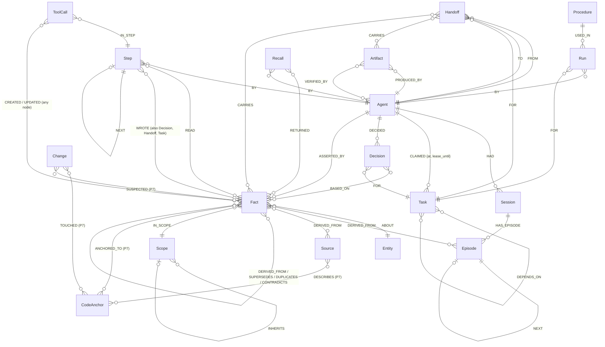

# Plexus graph model v1 (with the v1.1 / v1.2 / v1.3 additions of P1, P2 and P7, and v1.4 of P9)

> Some paths cited here (`docs/research/`, `docs/PLAN.md`, `docs/PLEXUS_REPORT.md`, `docs/spikes/`, `docs/VIDEO_SCRIPT.md`, `docs/BLOG_DRAFT.md`) are working files that are not in this repository.

Source of truth: `docs/PLAN.md` §2. The schema is applied by `plexus/queries/schema/*.cypher` through
`plexus.graph.schema.apply_schema`, and `plexus/tests/test_schema.py` checks the live indexes and constraints
against the lists below. If this file and the schema files disagree, that is a bug.

Every node has `id` (UUID string) and `created_at` (epoch ms). Embeddings are `vecf32`, 384-d, cosine.

## Diagram

The diagram is a summary (ER cardinalities are indicative). The edge table below is exact.

## Node labels

| Label | Key properties | Module |
|---|---|---|
| `Agent` | `id, name, role, harness` | all |
| `Scope` | `id, kind: user\|project\|global, name` | Engram |
| `Session` | `id, agent_id, started_at, ended_at` | Engram |
| `Episode` | `id, role, text, at, step, embedding` | Engram |
| `Entity` | `id, name, norm_name, kind, embedding, tok, num_key` | Engram. `tok`: sorted distinct casefolded name tokens (full-text candidate Jaccard); `num_key`: the discriminator key of the name (`engram.service.entity_key`: P9-c's numbers, unit-normalised quantities, number words and negation tokens, plus a hyphenated trailing letter, so `auth-service-a` and `auth-service-b` stay apart); two names are the same thing only if their keys are equal. Both written by `engram/resolve_entity`; `plexus migrate entities` backfills older entities (P9-d, P9-int). `norm_name` is UNIQUE |
| `Fact` | `id, subject_id, predicate, value, valid_from, valid_to (OPEN), recorded_at, status: active\|superseded\|quarantined\|forgotten\|dormant, confidence, embedding`; P7: `verify_state: verified\|suspect, suspect_since, verified_at, verify_after (OPEN), surprise, pinned`; P9: `dup_key, tok, tok_seq` (duplicate-detection features, see v1.4) | Engram (P7: Staleness, Activation) |
| `Source` | `id, uri, kind: doc\|tool\|note\|code\|external\|…, trust: normal\|high, title, text`; P7: `content_hash, commit, repo` | Lineage (P7: Staleness) |
| `Procedure` | `id, name, task_type, steps_json` | Engram |
| `Run` | `id, at, success, notes` | Engram |
| `Task` | `id, title, status: open\|claimed\|done\|failed, priority, lease_until, claimed_by, version, done_at` | Relay |
| `Handoff` | `id, at, note` | Relay |
| `Artifact` | `id, kind, uri, hash, summary` | Relay |
| `Decision` | `id, text, at` | Relay |
| `Step` | `id, n, at, agent_id` | Lineage |
| `ToolCall` | `id, tool, at, agent_id, query_name, run_time_ms, wrote` | audit (feeds the View) |
| `Recall` | `id, at, query, scope_id, agent_id, k`; D-013: `entities` (ids the query named), `separation` (bool) | lineage (record behind `why_recalled`) |
| `CodeAnchor` | `id` (`anc:` + sha1(path#symbol)[:16]), `repo, path` (canonical), `symbol` (`''` = whole file), `hash, kind: file\|function\|class, updated_at` | Staleness (P7) |
| `Change` | `id` (`chg:` + sha1(commit, at, hashes)[:16]), `commit, at, paths` (JSON list), `agent_id` | Staleness (P7) |

## Edges

| Module | Edge | Properties |
|---|---|---|
| Engram | `(Session)-[:HAS_EPISODE]->(Episode)` | |
| Engram | `(Episode)-[:NEXT]->(Episode)` | |
| Engram | `(Agent)-[:HAD]->(Session)` | |
| Engram | `(Fact)-[:ABOUT]->(Entity)` | |
| Engram | `(Fact)-[:DERIVED_FROM]->(Episode\|Source\|Fact)` | One edge per origin: a fact several documents support has one edge per `Source` (P13, D-015: `assert_fact(source_ids=[...])`, and a duplicate assert from a new document adds its edge). `quarantine_source` hides a fact only when none of its Sources is live, `forget_source` forgets it only when the forgotten Source was its last |
| Engram | `(Fact)-[:IN_SCOPE]->(Scope)` | |
| Engram | `(Scope)-[:INHERITS]->(Scope)` | |
| Engram | `(Fact)-[:SUPERSEDES]->(Fact)` | |
| Engram | `(Fact)-[:CONTRADICTS]->(Fact)` | |
| Engram | `(Fact)-[:DUPLICATES]->(Fact)` | `at, reopened` (P9-c: written by `confirm_duplicate`: the new fact is a merged duplicate of the old one; `split_duplicate` / undo removes it) |
| Engram | `(Fact)-[:DUPLICATES_MAYBE]->(Fact)` | `score, cos, jaccard, at` (P9-c: soft link from a NEW fact to an older one it may repeat; resolved by `confirm_duplicate` / `reject_duplicate`) |
| Engram | `(Fact)-[:ASSERTED_BY]->(Agent)` | `at`; P9: `text` (the agent's own wording), `via` (id of the fact whose merge created the edge) |
| Engram | `(Entity)-[:RELATES]->(Entity)` | `kind, scope_id, at` (P9-b: typed entity relation written by `assert_relation`, walked by `recall(hops)`; unique per (kind, scope)) |
| Engram | `(Procedure)-[:USED_IN]->(Run)` | |
| Engram | `(Run)-[:BY]->(Agent)` | |
| Engram | `(Run)-[:FOR]->(Task)` | |
| Relay | `(Task)-[:DEPENDS_ON]->(Task)` | |
| Relay | `(Agent)-[:CLAIMED]->(Task)` | `at, lease_until` |
| Relay | `(Handoff)-[:FROM]->(Agent)`, `(Handoff)-[:TO]->(Agent)`, `(Handoff)-[:FOR]->(Task)` | |
| Relay | `(Handoff)-[:CARRIES]->(Artifact\|Fact)` | |
| Relay | `(Agent)-[:DECIDED]->(Decision)` | |
| Relay | `(Decision)-[:BASED_ON]->(Fact)` | |
| Relay | `(Decision)-[:FOR]->(Task)` | |
| Relay | `(Artifact)-[:PRODUCED_BY]->(Agent)` | |
| Relay | `(Artifact)-[:VERIFIED_BY]->(Agent)` | |
| Lineage | `(Step)-[:BY]->(Agent)` | |
| Lineage | `(Step)-[:READ]->(Fact)` | P7: `via: recall\|use, at, suspect` |
| Lineage | `(Step)-[:WROTE]->(Fact\|Decision\|Handoff\|Task)` | P9-int: for a new Fact, Decision and Handoff the write statement itself creates the edge (the Step is opened first), so a crash cannot leave one without it |
| Lineage | `(Step)-[:NEXT]->(Step)` | |
| audit | `(ToolCall)-[:IN_STEP]->(Step)` | |
| audit | `(ToolCall)-[:CREATED\|UPDATED]->(any)` | |
| lineage | `(Recall)-[:RETURNED {rank, score, sep}]->(Fact)` (`sep` = the D-013 context term of that row: entity cue + predicate cue, 0 when none), `(Recall)-[:BY]->(Agent)`, `(Recall)-[:IN_STEP]->(Step)` | |
| Staleness (P7) | `(Fact)-[:ANCHORED_TO]->(CodeAnchor)` | `at` |
| Staleness (P7) | `(Source)-[:DESCRIBES]->(CodeAnchor)` | `at` |
| Staleness (P7) | `(Change)-[:TOUCHED]->(CodeAnchor\|Source)` | |
| Staleness (P7) | `(Change)-[:SUSPECTED]->(Fact)` | `at` |
| Staleness (P7) | `(Fact)-[:VERIFIED_BY]->(Agent)` | `at, commit, outcome: confirmed\|changed, evidence` |

## Indexes and constraints

Created by `queries/schema/{indexes,fulltext,vector}.cypher` (idempotent) and `apply_schema`.

| Kind | Label.property | Why |
|---|---|---|
| Range | `id` on **every** label (18, including `Recall`, `CodeAnchor`, `Change`) | entry point of every query; the UNIQUE constraints need it |
| Range | `Fact.subject_id`, `Fact.predicate`, `Fact.valid_to`, `Fact.status` | four separate single-property indexes (FalkorDB range indexes here are not composite): `predicate` / `valid_to` / `status` serve the as-of and active-only filters; the current-fact lookup of `assert_fact` starts at the Entity and uses them as filters |
| Range | `Task.status` | ready-task scans for `claim_next_task` |
| Range | `Step.n`, `Step.agent_id` | time-machine (step N); the agent's latest step and `knew_at` |
| Range | `ToolCall.at` | flow feed ordering |
| Range | `Entity.norm_name` | entity MERGE key (also `UNIQUE`, see below) |
| Range | `created_at` on **every** label (18) | `view/subgraph`: the Explorer's label / time-window filter is one index range seek per label instead of an All Node Scan |
| Range | `CodeAnchor.path`, `Change.at` | P7: the file-level symbol lookup of `anchor_fact`, and the change feed of `docs_to_update` |
| Range | `Fact.verify_degraded` | P12-F3: the unfinished-verification branch of `staleness/suspect_ids` (equality) |
| Range | `Fact.verify_state`, `Fact.verify_after` | P7: the suspect scan (`staleness/suspect_ids`): an equality branch and a review-date range branch instead of one OR |
| Range | `Fact.pinned` | P7: the pinned count of `view/inventory_memory` |
| Range | `Source.uri`, `Scope.name`, `Procedure.task_type` | MERGE keys of `create_source`, `create_scope` (with `kind`) and `log_procedure_run` (with `name`); `best_procedure` filter |
| Full-text | `Entity.name`, `Fact.value`, `Episode.text` | keyword entity resolution and recall |
| Vector (384-d, cosine) | `Entity.embedding`, `Fact.embedding`, `Episode.embedding` | semantic seeds for recall |
| UNIQUE constraint | `Task.id`, `Fact.id`, `Agent.id`, `Decision.id`, `Handoff.id` | no duplicate ids; `apply_schema` waits until each is `OPERATIONAL` |
| UNIQUE constraint | `Entity.norm_name` | backstop behind `engram/resolve_entity` (which already MERGEs on it). `resolve_entity_ex` retries once on `unique constraint violation`. A graph that still holds two entities with one `norm_name` ends this constraint `FAILED`: `apply_schema` logs a warning instead of raising, and `plexus migrate entities` lists the duplicates |

## Conventions

- **OPEN sentinel.** FalkorDB cannot store null properties, so an open-ended `valid_to` is
  `OPEN = 9_999_999_999_999`. "Currently valid" means `valid_to = OPEN` (or `valid_to > now`).
- **Time is epoch milliseconds (integers).** There is no `datetime()` on 6.0.2. Use `timestamp()` or pass
  `now` as a parameter (preferred, so tests are deterministic).
- **Ids are UUID strings we generate** (`randomUUID()` in Cypher or Python `uuid4`). FalkorDB's internal
  `id()` is not stable and is never stored or exposed.
- **Maps are JSON strings.** Map and null-containing array properties are rejected, so maps go through
  `toJSON()` (for example `Procedure.steps_json`).
- **Vector scores are distances.** Cosine `score` is lower-is-nearer: `ORDER BY score ASC`.
- **Graph naming.** One graph per tenant: `plexus_t_<tenant>` with `^[a-z0-9_]{1,48}$`
  (`plexus.graph.tenancy.graph_name`). Tests use `test_<uuid hex>` and delete the graph in teardown.
  Agents never pass a graph name; the tenant is bound per connection.
- **Statuses** are lowercase strings: `Fact.status` ∈ `active|superseded|quarantined|forgotten|dormant`,
  `Task.status` ∈ `open|claimed|done|failed`.
- **Bounded writes.** One statement per operation, `UNWIND` sizes bounded by the caller. `LIMIT` does not stop
  eager writes (`CREATE/SET/MERGE/DELETE`).

## Properties added during P1 (orchestrator-approved; graph model v1.1)

| Where | Property | Why |
|---|---|---|
| `Fact` | `norm_value` | normalised value used for exact duplicate detection |
| `Fact` | `value_embedding` (vecf32 384, no index) | value-only embedding for the paraphrase check. The full-sentence `embedding` put different values within 0.08 (e.g. PostgreSQL 16 vs MySQL 8 at 0.082); value-only separates them (0.064 same vs 0.165 different) |
| `Session` | `ended_at = OPEN` at creation | no null properties |
| `Episode` | `step = -1` when no step is given | no null properties |
| `Task` | `fail_reason`; `version` also bumped by complete/fail | CAS and diagnostics |
| `Artifact` | `task_id` | direct lookup without traversal |
| `Handoff`, `Decision` | `created_at` | ordering |
| `CLAIMED` edge | `reclaimed_from` (`''` when not a reclaim) | dead-agent recovery evidence |
| `VERIFIED_BY` edge | `at` | audit |

## Additions during P1-fix and P2 (graph model v1.2)

| Where | Addition | Why |
|---|---|---|
| `Fact` | `value_tokens` | numeric/version tokens. A paraphrase counts as a duplicate only when they are identical (v1 ≠ v2, 8080 ≠ 8081) |
| `Fact` | `forgotten_at`, `quarantined_at`, `prior_status` | Lineage forgetting and reversible quarantine |
| `Source` | `quarantined_at` | P13 (D-015): set by `lineage/quarantine` (first quarantine wins), removed by `lineage/release_quarantine`. A Source without it is *live*: a fact it supports stays visible when another Source is quarantined |
| `Source` | `title`, `text` | optional human-readable name and excerpt, written by `lineage/create_source` (empty string when absent) |
| `Decision` | `flagged`, `flag_reason` | flagged (not deleted) when a fact it is `BASED_ON` is forgotten |
| `Task` | `seq` | FIFO tie-break for claims, by `create_tasks` input order |
| `Task` | `reopened_by`, `reopened_at` | `reopen_task` for failed tasks |
| `ToolCall` | `step` (-1 when none) | step number without a traversal |
| `ASSERTED_BY` edge | `at` | when each agent asserted (also for duplicates) |
| `VERIFIED_BY` edge | `independent` | self-verification is allowed but marked |
| `(Artifact)-[:FOR]->(Task)` | new edge (the `task_id` property is kept) | the artifact links to its task in the graph |
| Step attachment | a separate `link_step` statement right after the write | Lineage decision: atomicity of a provenance edge vs. editing every Engram/Relay query (see `docs/queries.md`). **Since P9-int `assert_fact`, `record_decision` and `handoff` fold the `WROTE` edge into their own statement** (v1.4 below); every other tool still links after its write |

## Additions during P7 (graph model v1.3): staleness and activation forgetting

All additive: data written before P7 lacks these properties, and every query reads them with `coalesce` (absent =
the default). The names are fixed by the shared contract of the two P7 builds; the reasoning is in `docs/DECISIONS.md`
D-011 (staleness) and D-012 (activation forgetting); the behaviour is in `docs/staleness.md` and `docs/forgetting.md`.

| Where | Addition | Default when absent | Why |
|---|---|---|---|
| `Fact` | `verify_state` `'verified'\|'suspect'` | `'verified'` | a code change makes a fact *suspect*, never false; an agent re-checks it |
| `Fact` | `suspect_since` (epoch ms) | `0` | when it became suspect; orders the work list |
| `Fact` | `verified_at` (epoch ms) | `0` | last `verify_fact` |
| `Fact` | `verify_degraded` (bool) | absent | `verify_fact(changed)` started (written before the supersede) and did not finish, or superseded the fact but could not backdate it; calling it again finishes the job and removes the flag |
| `Fact` | `verify_after` (epoch ms) | `OPEN` | a review date for facts that are not about code; once passed the fact is suspect too |
| `Fact` | `surprise` (float 0..1) | `0.0` | set once at write from the novelty of the fact; raises its starting activation |
| `Fact` | `pinned` (bool) | `false` | the owner says it must stay prominent; protects it from fading and from sweeps |
| `Fact` | `salience` (float 0..1), `salience_at` (epoch ms) | absent (recomputed on read) | D-013 graded salience from the graph (decisions, verifications, independent artifacts, done tasks, using agents, handoffs, trusted source, pin). Written by `pin_fact` (≥ 0.95), removed by `unpin_fact`; the activation read recomputes it from the edges, so the cache is informational |
| `Fact` | `status = 'dormant'`, `prior_status`, `dormant_at` | n/a | an optional, reversible sweep hides faint, unprotected facts from recall; `restore_fact` puts `prior_status` back. Nothing is deleted |
| `Source` | `kind` also `code`, `doc`, `external` | | what the Source is |
| `Source` | `content_hash`, `commit`, `repo` | `''` | hash of the file the `uri` names and the commit that last reported it (`mark_changed`) |
| `Source` | `trust` is the **string** `'normal'` or `'high'` | `'normal'` | `'high'` protects the facts derived from it. Data written before P7 holds a float (1.0); any float reads as `'normal'` |
| `READ` edge | `via` `'recall'\|'use'`, `at` | `'recall'`; the Step's `at` | being *shown* a fact is weighed less than *using* it (weights 0.3 vs 1) |
| `READ` edge | `suspect` (bool, written by `record_recall`) | unknown | the fact was suspect (contract rule) when the recall happened; such a recall never counts, even after the fact is verified |
| `VERIFIED_BY` edge | `outcome`, `commit`, `evidence` (on Fact→Agent edges) | | the audit of a re-check; it counts as a weight-2 activation event |
| `CodeAnchor`, `Change` | nodes (tables above) | | the code a fact is about, and the code change that made facts suspect |
| `ANCHORED_TO`, `DESCRIBES`, `TOUCHED`, `SUSPECTED` | edges (table above) | | fact→code, doc→code, change→code/doc, change→fact |

A fact is **suspect at time t** if `coalesce(verify_state,'verified') = 'suspect'` OR `coalesce(verify_after, OPEN) <= t`.
Canonical paths (`CodeAnchor.path`, doc `Source.uri`) are absolute, `/`-separated, with an upper-case drive letter and no
trailing slash.

## Additions during P9 (graph model v1.4): duplicates, typed relations, atomic entities

All additive. Facts and entities written before P9 lack the new properties; every query reads them through a guard
(a fact without `dup_key` only matches by `norm_value`: a missed merge, never a wrong one).

| Where | Addition | Why |
|---|---|---|
| `Entity` | `tok` (sorted distinct name tokens), `num_key` (discriminator key, see the node table) | the Jaccard / key guards of the atomic `engram/resolve_entity` statement (P9-d) |
| `Entity` | UNIQUE(`norm_name`) | backstop behind the resolve-or-create statement; `resolve_entity_ex` retries once on its error |
| `Fact` | `dup_key` | P9-c discriminator multiset (numbers, quantities, number words, negation / antonyms) as one string; a duplicate needs equal keys |
| `Fact` | `tok`, `tok_seq` | stemmed content tokens (sorted unique, and in order) for the Jaccard tier and the word-order / one-word-substitution guards |
| `ASSERTED_BY` edge | `text`, `via` | the raw wording the agent used (so a merge is reversible) and the merged fact that created the edge |
| `(Fact)-[:DUPLICATES]->(Fact)` | `at`, `reopened` | `confirm_duplicate` decision record (the merged fact keeps a zero-width window) |
| `(Fact)-[:DUPLICATES_MAYBE]->(Fact)` | `score, cos, jaccard, at` | the soft link between a new fact and the older one it may duplicate; `recall` rows carry `maybe_duplicate_of`; the View marks the fact |
| `(Entity)-[:RELATES]->(Entity)` | `kind, scope_id, at` | typed relation (`assert_relation`), walked by `recall(hops)` (P9-b) |
| `(Step)-[:WROTE]->(x)` | written by the write statement of `assert_fact` / `record_decision` / `handoff` | crash-consistency (L6-F: 94 of 1,240 records had no edge when the link was a second statement) |

Not graph elements, but part of the same release: the MCP tool table carries a `kind` (`read` or `write`) per tool, and
the per-tenant audit mode (`off` / `light` / `full`, see `docs/mcp.md` "Audit modes") decides whether a read tool writes a
`ToolCall`, a `Step` and `READ` edges.
